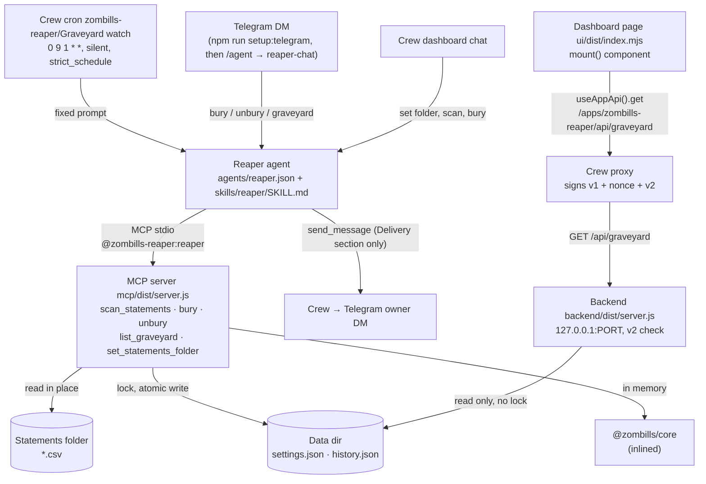
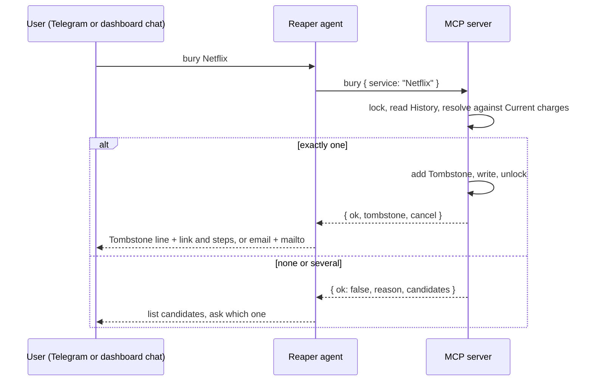

# Design Document: reaper

## Overview

The Reaper is a Kiro Crew 0.12.2 app made of five pieces that share one History file:

1. **A stdio MCP server** (`mcp/`, bundled to `mcp/dist/server.js`) with the tools `scan_statements`, `list_graveyard`, `bury`, `unbury` and `set_statements_folder`. It is the only code that reads statements and the only code that writes the History. It runs `@zombills/core` in memory and returns summaries.
2. **The Reaper agent** (`agents/reaper.json`) and **its skill** (`skills/reaper/SKILL.md`). The agent calls the MCP tools, words the alerts and drafts, and sends the monthly alert to Telegram with Crew's `send_message`. **Amended by skeleton check 2026-11-17:** the skill cannot be loaded in an unattended cron run (`load_resource` is rejected), so `scripts/build.ts` generates `agents/reaper.json` with the skill text inlined in its `prompt`. `SKILL.md` stays the single source of that text and is still registered for dashboard chats ("Agent" and "Skill" below).
3. **A monthly cron** in `app.json` that sends one fixed prompt to the agent.
4. **A read-only backend** (`backend/`, bundled to `backend/dist/server.js`) that serves the graveyard to the dashboard after the proxy v2 HMAC check.
5. **A dashboard page** (`ui/`, bundled to `ui/dist/index.mjs`) that shows the graveyard over time.

A shared module (`shared/src/`) holds the History types and codec, the Settings codec, the graveyard summary, the Money text formatter and the Display name rule. The MCP server and the backend import its code; the page imports its types and the Money text formatter.

Nothing is installed at runtime. esbuild inlines `@zombills/core`, `papaparse`, the MCP SDK and every other library into three committed single-file bundles, and the root `package.json` has no runtime `dependencies` (Req 2.6, 2.8). A freshness test rebuilds them and compares bytes (Req 2.9).

Delivery to Telegram and inbound "bury" from Telegram are **not tested yet** (spike Q6, Q7). Both are kept behind one section of the skill and one line of the README, so a failed Telegram test changes those two places, the alert's last line and the cron's `silent` flag, and nothing else ("Telegram isolation" below).

### Design decisions

| Decision | Choice | Reason |
| --- | --- | --- |
| MCP launch | `"command": "/bin/sh", "args": ["-c", "exec node \"$HOME/.kiro/crew/apps/zombills-reaper/mcp/dist/server.js\""]`, no `env`, no `autoApprove` | Spike Q2: `${HOME}` in `args` is not expanded on the session path and the server never starts; the shell form worked 2/2. `autoApprove` stopped the server mounting 5/5 (spike Q5b). `exec` replaces the shell, so kiro-cli's stdio pipes reach `node` directly and a kill reaches it too |
| Tool references | Agent `tools: ["@kirocrew-core", "@zombills-reaper:reaper"]`, `allowedTools: ["@zombills-reaper:reaper"]` | Spike Q5: app servers are namespaced `<app>:<server>`; a bare `@reaper` dangles silently. Spike Q5b: a tool only in `tools` is rejected in an unattended cron run |
| Where the MCP server finds its data | `appRoot = resolve(dirname(fileURLToPath(import.meta.url)), "../..")`; Data dir `= appRoot/data` | The bundle sits at `<App root>/mcp/dist/server.js`. kiro-cli starts the server in a per-run cwd (`~/workplace/kirocrew-workspace/cron_<id>_<run>`, spike Q3) and passes no app variables (requirements, "Findings") |
| Where the backend finds its data | `<process.cwd()>/data` | Crew spawns the backend with cwd = App root (`apps/backend.py`) |
| Shared module | Top-level `shared/src/`, imported by relative path, inlined into each bundle | One copy for MCP and backend (Req 15.2). A top-level folder keeps `backend/` from importing `mcp/` internals. `structure.md` gains this folder (Req 15.3) |
| Proxy check | v2 only: `X-KiroCrew-Proxy-V2` + `X-KiroCrew-Proxy-Nonce`, nonce accepted once by a process-lifetime replay cache; v1 ignored | Spike Q8d and `apps/proxy_auth.py` (`verify_proxy_request_v2`). v1 can be replayed within 60 s; v2 cannot |
| Skill text in the agent | `scripts/build.ts` writes `agents/reaper.json`: `prompt` = the base prompt of `agents/reaper.base.json` + a blank line + the full text of `skills/reaper/SKILL.md` with its front-matter stripped. The generated file is committed and the freshness test compares it byte for byte | Skeleton check 2026-11-17: in a cron run the agent asks `load_resource` for the skill and the call is rejected (unattended approval); adding `load_resource` to `allowedTools` did not help, and each run waited about 196 s. A prompt needs no tool call. One source (`SKILL.md`) keeps the dashboard-chat skill and the cron prompt from drifting |
| Page export | `export function mount()` is a React function component, also the default export | Spike Q8b: the host renders `mount` as a component; a DOM-style `mount(el)` crashes |
| Page imports | Only `react` and `@kirocrew/app-sdk` (host import map, spike Q8b). No `react-dom`, no `lucide-react`, no `react/jsx-runtime` | Only those two bare imports were proven in a running page. The host import map also lists `react/jsx-runtime`, `react-dom` and `lucide-react` (`kiro_crew/static/dist/index.html`), but the page keeps to the two proven imports. JSX is compiled with the classic transform to `h(…)` from `react`, so the bundle does not import `react/jsx-runtime`. **Amended by Batch 9 (user approved 2026-11-17):** the page also imports host components from `@kirocrew/app-sdk/ui` once task 32 confirms the import map lists it |
| Page route and API path | `ui.pages[0].route = "/apps/zombills-reaper"`; data from `api.get("/apps/zombills-reaper/api/graveyard")`; `permissions.api = ["/apps/zombills-reaper/api"]` | Spike Q8c. Amends Req 1.6, 12.1, 12.2 |
| Lock scope | The lock covers only the History read-modify-write. Reading and parsing statements happens before the lock is taken | Parsing 120 files can take seconds; the diff and the write take milliseconds. A short critical section keeps `history-busy` rare when a Telegram chat and the cron run together (each run has its own MCP process, spike Q10) |
| Lock timings | Poll every 50 ms for up to 5,000 ms; a lock is stale when its mtime is older than 30,000 ms or its `pid` is not alive | Req 7.6 leaves both to design. 30 s is far above the longest critical section (one History decode, diff and write) |
| Merging overlap between files | Count per key per file, keep the largest count; the kept transactions are chosen by content, never by file order | Req 4.4 and the order-independence property (Req 4.7) |
| Tombstone key | A Tombstone matched in a scan takes the subscription's current `id` as its `key` | Keeps pass 1 of the Match working after Core changes an id. Idempotent, so Req 16.11 holds |
| Unexpected errors | Every tool handler catches; the result is `{ ok: false, reason: "internal-error" }` and one stderr line with the error's `name` and `code` only | A thrown handler would put a stack trace with paths into the agent's context. `"internal-error"` is a reason code added by this design (Req 5.9 amended by design review 1 #11) |
| JSX | esbuild `jsx: "transform"`, `jsxFactory: "h"`, `jsxFragment: "Fragment"`, with `import { createElement as h, Fragment } from "react"` in each `.tsx` file | The import map does provide `react/jsx-runtime` (design review 1 #12), so either transform would load. The classic transform keeps the bundle's bare imports to the two the spike proved in a running page |
| Scripts | `scripts/*.ts` run with `node` directly (Node 22.18+ strips types by default); erasable TypeScript only, no enums or parameter properties. Scripts import each other with `.ts` specifiers, so `tsconfig.json` sets `allowImportingTsExtensions` (with `noEmit`) | No `tsx` or `ts-node` dependency. Node's type stripping does not map `.js` specifiers to `.ts` files, so only `scripts/` runs from source; `mcp/src` and `backend/src` run only as bundles or under Vitest. The scripts never run at Crew runtime (`structure.md`) |
| Chart | Hand-written SVG in the page, `aria-hidden`, beside a table with the same numbers | No chart library; the table is the accessible view (Req 12.3, 12.6). **Amended by Batch 9 (user approved 2026-11-17):** fixed-size SVG (no stretching) with fixed bar width, axis, value labels and a legend, bars for yearly cost and saved so far, theme CSS variable colours; one month must not fill the box (task 32) |
| Demo amounts | Fixed in "Demo statements" below. The first-count line becomes "6 undead, $1,181.40 a year in USD" | Req 9.4 leaves the amounts to design; the requirement's $1,104.36 was an example |

---

## Spike results and how the design uses them

`spike-2026-11-17.md` overrides every assumption in the requirements. The amended criteria carry an "Amended by spike 2026-11-17" note in `requirements.md`.

| Spike # | Result | Used in |
| --- | --- | --- |
| 1 | `kirocrew app install <dir>` copies the tree; the CLI refuses to enable a third-party app, the user enables it in the dashboard (Apps → Library → The Reaper → Enable). `kirocrew app update zombills-reaper` re-copies | README install steps; never set `agent.apps_allow_third_party` |
| 2 | `/bin/sh -c "exec node \"$HOME/…\""` works; `${HOME}` in `args` does not | Manifest, `app-manifest.test.ts` |
| 3 | In the sandboxed cron session the server can read `~/Documents` and write `<App root>/data`; cwd is a per-run workspace | `app-paths.ts` ignores cwd |
| 4 | `"agent": "reaper"` (bare) works; the cron is `zombills-reaper/Graveyard watch`; the agent file is `~/.kiro/agents/zombills-reaper--reaper.json` | Cron entry, README "Run it now" |
| 5 | Tools must be `@zombills-reaper:reaper`; Crew adds `managedToolPolicy.exclude` with most Crew tools. Whether `read`, `glob`, `grep` are mounted was not listed | Agent file; Telegram test T8 records the real surface for the README (Req 8.3) |
| 5b | `allowedTools` needed for unattended runs; `autoApprove` breaks mounting | Agent file; Telegram test T2 for `send_message` |
| 6, 7 | Telegram delivery and inbound routing not tested | "Telegram isolation", "Telegram test" |
| 8 | `ui.entry` relative to `ui/`; `mount` is a React component; `react` and `@kirocrew/app-sdk` resolve; `permissions.api` prefix match without trailing slash; proxy sends v1 + nonce + v2 headers; backend env has `KIROCREW_PROXY_SECRET` | Manifest, page, backend |
| 9 | `.app_secret` exists after a local install | Backend start check (Req 11.2) |
| 10 | Each cron run spawns a fresh MCP server process and kills it after the run | Cross-process lock; no in-process cache of the History |
| 11 | `kirocrew cron trigger <id>` works; a run takes about 8 to 40 s | README "Run it now", demo script |

---

## Architecture



### Monthly round

```mermaid
sequenceDiagram
    participant C as Crew cron
    participant A as Reaper agent
    participant M as MCP server (fresh process)
    participant H as History file
    participant T as send_message → Telegram
    C->>A: "Run the monthly round of the reaper skill."
    A->>M: scan_statements {}
    Note over M: read settings, list folder,<br/>parse + normalise each file,<br/>merge, detect (no lock held)
    M->>H: take history.lock
    M->>H: read + decode
    Note over M: match, classify with Tombstone answers,<br/>build summary and next History
    M->>H: write tmp, fsync, rename; release lock
    M-->>A: Scan summary
    alt something to report
        A->>T: one alert (Delivery section)
        A-->>C: same text as the run's reply
    else nothing new
        A-->>C: "All quiet in the graveyard this month."
    end
```

### "Bury" reply



## Module layout

```
app.json                          manifest (Req 1)
app-manifest.test.ts              Req 1.8, 8.4, 10.4; root package.json has no lifecycle scripts; no tracked data/
package.json, package-lock.json   no "dependencies", no lifecycle scripts; devDependencies only (Req 2.6); lock committed
tsconfig.json, eslint.config.js, .prettierrc, vitest.config.ts
agents/reaper.base.json           hand-written agent: name, description, tools, allowedTools, base prompt (Req 8)
agents/reaper.json                GENERATED by scripts/build.ts from reaper.base.json + SKILL.md; committed; never edited by hand
skills/reaper/SKILL.md            skill (Req 9); source of the text inlined into agents/reaper.json
shared/src/
  types.ts                        History, TrackedCharge, Tombstone, ScanRecord, Settings, tool result types
  history-codec.ts (+ .test, .property.test)   decodeHistory, encodeHistory, emptyHistory, limits
  settings-codec.ts (+ .test)     decodeSettings, encodeSettings
  graveyard-summary.ts (+ .test, .property.test)   graveyardView(history, timeZone)
  money.ts (+ .test)              CADENCE_FACTOR, moneyText(cents, currency)
  display-name.ts (+ .property.test)   displayName(text), foldName(text)
  local-date.ts (+ .test)         localDate(date, timeZone), localMonth(iso, timeZone)
  ref.ts (+ .test)                refOf(key): first 12 hex of sha256, the only id tools return
mcp/src/
  server.ts                       the only file that imports @modelcontextprotocol/sdk; registers tools
  tools.ts (+ .test)              createReaperTools({ dataDir, appRoot, now, timeZone, coreSource }) → handlers
  app-paths.ts                    appRootFromModule(import.meta.url), dataDirOf(appRoot)
  core-source.ts                  CORE_SOURCE (esbuild define __CORE_SOURCE__)
  log.ts                          logCounts(event, counts): one stderr line, numbers and reason codes only
  data-files.ts (+ .test)         ensureDataDir, writeFileAtomic, rotateKeep3
  history-lock.ts (+ .test, two-process test)   withHistoryLock(dataDir, fn, timings)
  history-store.ts (+ .test)      loadHistoryForWrite, readHistory, saveHistory
  statement-files.ts (+ .test)    listStatementFiles, readStatementFile
  decode-bytes.ts (+ .test)       decodeStatementBytes (UTF-8, BOM, Windows-1252)
  read-statements.ts (+ .test)    readAll(folder) → { files, transactions } (parse + normalise per file, skip kinds)
  merge-transactions.ts (+ .property.test)   mergeOverlap(perFile)
  match.ts (+ .property.test)     matchRecords(subscriptions, records) → pairs, unmatched, blocked
  scan-diff.ts (+ .test, .property.test)   pure: diffScan(input) → { summary, nextHistory }
  scan-statements.ts (+ .test, .property.test)   tool orchestration
  resolve-service.ts (+ .test)    resolveService(text, entries) → one | none | several, candidates
  cancel-draft.ts (+ .test)       cancelDraft(tombstone) → link | email
  bury.ts, unbury.ts, list-graveyard.ts, set-statements-folder.ts (+ .test each)
  bundle.test.ts                  Req 2.10: start the bundle from a temp app root, tools/list
  privacy-network.test.ts         Req 13.2
  privacy-logs.test.ts            Req 13.3
  data-dir-files.test.ts          Req 13.4
  demo.test.ts                    Req 14.4
mcp/fixtures/
  demo/round-1/*.csv, demo/round-2/*.csv
  generators.ts                   fast-check arbitraries for statements and Histories
backend/src/
  server.ts                       node:http, env check, routing
  env.ts (+ .test)                readBackendEnv(process.env)
  proxy-check.ts (+ .test, .property.test)   verifyProxyV2, signProxyV2 (test-only reference signer lives in the test)
  replay-cache.ts (+ .test)       ReplayCache
  routes.ts (+ .test)             handle(req parts, dataDir) → status + JSON
  bundle.test.ts                  Req 2.10: start the bundle, GET /api/health
ui/src/
  index.tsx                       export function mount(); export default mount
  graveyard-page.tsx (+ .test.tsx)   states and data view
  savings-headline.tsx, timeline-table.tsx, timeline-chart.tsx, tombstone-list.tsx
  page-text.ts                    every sentence on the page
  graveyard-response.ts (+ .test) isGraveyardResponse(value): runtime shape check of the API reply
  app-sdk.d.ts                    ambient types for @kirocrew/app-sdk (useAppApi)
scripts/
  sync-core.ts (+ .test)          Req 2.1–2.5
  build.ts                        esbuild API + agent generation; build({ outDir }) used by npm run build and the freshness test
  build-fresh.test.ts             Req 2.9
  privacy-source.test.ts          Req 13.1
  privacy-bundle.test.ts          Req 13.1 for the three committed bundles (named allowlist)
vendor/zombills-core/             dist/, package.json, SOURCE (synced, never edited)
```

The `mcp/src/*.ts` files other than `server.ts`, `app-paths.ts` and `log.ts` take the Data dir, the clock and the time zone as arguments. Tests call `createReaperTools` with a temp Data dir and a fixed clock; no test needs an environment variable or the real App root.

### Dependencies

All are `devDependencies` with exact versions; the bundles inline what runs. Versions match Zombills where Zombills uses the package (`papaparse` 5.7.1, `typescript` 6.0.3, `vitest` 5.1.0, `fast-check` 4.10.2, `eslint` 10.14.0, `prettier` 3.10.1, `typescript-eslint` 8.72.2, `@testing-library/react` 16.3.3, `jsdom` 31.0.1, `@types/react` 18.3.31, `@types/node` 24.19.2). New to this repo (Req 13.5):

| Package | Why | Network behaviour |
| --- | --- | --- |
| `@zombills/core` (`file:./vendor/zombills-core`) | Domain logic | None (Zombills rule) |
| `papaparse` 5.7.1 | Core's runtime dependency | Its `download: true` option fetches; Core never sets it |
| `@modelcontextprotocol/sdk` (exact pin, chosen in task 1) | stdio MCP server. Only `server/mcp.js` and `server/stdio.js` are imported | The package also has HTTP/SSE client and server transports. They are not imported, so esbuild does not include them; `privacy-source.test.ts` fails on any other SDK subpath import |
| `zod` (exact pin, the version the pinned SDK names as its peer) | The SDK's schema peer, used for tool input schemas. Task 1 checks that the pinned SDK's `registerTool` accepts a `.strict()` `ZodObject` as `inputSchema` and rejects an unknown key; if it does not, the handlers check for unknown keys themselves | None |
| `esbuild` (exact pin) | Build only | Its npm install script fetches the platform binary from the npm registry at `npm ci` time; never at runtime |
| `react` 18.3.1, `react-dom` 18.3.1 | Types and component tests only; external in the bundle, never imported by the page | None |
| `@testing-library/react` 16.3.3, `@testing-library/dom` (exact pin of a 10.x release, its peer), `jsdom` 31.0.1 | Component tests. `@testing-library/react` 16 needs `react-dom` and `@testing-library/dom` as peers | None |

Every version above is exact in `package.json` and locked in the committed `package-lock.json`.

---

## Types (`shared/src/types.ts`)

Money is integer cents; dates are ISO `yyyy-mm-dd` unless named `…At`, which are ISO date-times in UTC.

```ts
import type { Cadence } from "@zombills/core";

export type ReaperLabel = "possessed" | "trial-trap";

export interface Settings {
  version: 1;
  statementsFolder: string;          // absolute path; never logged or returned
}

export interface TrackedCharge {
  key: string;                       // Core subscription id last matched
  merchant: string;                  // Display name, ≤ 80 code points
  serviceId: string | null;
  currency: string;                  // ISO 4217
  cadence: Cadence;
  merchantKey: string;
  amountCents: number;               // current amount at the last match
  cadenceAssumed: boolean;
  firstSeenScan: string;             // scanId
  lastSeenScan: string;              // scanId
  reportedRiseDate: string | null;   // latestRise.date last reported
}

export interface Tombstone {
  key: string;
  name: string;                      // Display name
  serviceId: string | null;
  currency: string;
  cadence: Cadence;
  merchantKey: string;               // needed for the Triple in Match pass 2
  amountCents: number;
  cadenceAssumed: boolean;
  yearlySavingCents: number | null;  // null when cadenceAssumed
  buriedAt: string;                  // local date
  risenReportedThrough: string | null;
}

export type YearlyTotals = Record<string, { yearlyCostCents: number; guessedCount: number }>;

export interface ScanRecord {
  scanId: string;                    // "scan-<yyyymmddThhmmssZ>-<6 hex>"
  scannedAt: string;
  statementRange: { from: string; to: string };
  undeadCount: number;
  yearlyTotals: YearlyTotals;
  newCount: number;
  possessedCount: number;
}

export interface History {
  version: 1;
  coreSource: string | null;         // SOURCE line 1 of the last scan
  trackedCharges: TrackedCharge[];
  tombstones: Tombstone[];
  scans: ScanRecord[];               // oldest first
  reportedTrials: string[];          // keys
}
```

`Tombstone.merchantKey` is not in the Req 6.2 field list, but the Glossary "Match" needs the Triple of a Tombstone, and the Triple includes `merchantKey`. It is added here and in the codec (Req 6.2 and 7.1 amended by design review 1 #11).

**No key in a tool result** (design review 1 #3). A Core `id`, a Tracked charge or Tombstone `key` and a `merchantKey` can hold cleaned description text that the Display name hides: for an unidentified merchant the key is `unidentified:<processor>:<residue>`, and the residue keeps phone numbers, references and store numbers (`normalize/unidentified.ts`, `normalize/clean.ts`). These values stay in the History, on the machine. Tool results and backend replies carry `ref` instead: `createHash("sha256").update(key, "utf8").digest("hex").slice(0, 12)` (`shared/src/ref.ts`). The agent never needs either, because `bury` and `unbury` resolve by name; `ref` only lets the agent tell two entries apart. `bury` returns `tombstone` as a `TombstoneView`, and `list_graveyard` and `/api/graveyard` return `TombstoneView[]`.

Tool results (`ToolResult<T> = ({ ok: true } & T) | { ok: false; reason: Reason; candidates?: Candidate[] }`):

```ts
export type Reason =
  | "not-configured" | "folder-missing" | "no-statements"
  | "history-unreadable" | "history-newer" | "history-busy"
  | "not-absolute" | "not-found" | "not-a-folder" | "not-readable" | "inside-app"
  | "no-scan" | "ambiguous" | "internal-error";

export type SkipKind =
  | "too-large" | "unreadable" | "unknown-columns" | "empty"
  | "parse-error" | "ambiguous-dates" | "too-many";

export interface UndeadEntry {
  ref: string; name: string; serviceId: string | null; currency: string; cadence: Cadence;
  amountCents: number; yearlyCostCents: number; cadenceAssumed: boolean;
  labels: ReaperLabel[]; firstChargeDate: string; lastChargeDate: string; buried: boolean;
}
export interface PossessedEntry {
  ref: string; name: string; currency: string; cadence: Cadence;
  fromAmountCents: number; toAmountCents: number; increasePerYearCents: number;
}
export interface TrialTrapEntry {
  ref: string; name: string; currency: string; cadence: Cadence;
  amountCents: number; firstFullChargeDate: string;
}
export interface RisenEntry {
  ref: string; name: string; currency: string; amountCents: number;
  buriedAt: string; lastChargeDate: string;
}
/** A Tombstone as tools and the backend return it: no key, no merchantKey. */
export type TombstoneView = Omit<Tombstone, "key" | "merchantKey"> & { ref: string };
export interface ScanSummary {
  scanId: string; firstScan: boolean; folderName: string;
  files: { read: number; skipped: Partial<Record<SkipKind, number>> };
  statementRange: { from: string; to: string };
  newUndead: UndeadEntry[]; possessed: PossessedEntry[]; trialTraps: TrialTrapEntry[];
  risenAfterBurial: RisenEntry[]; undead: UndeadEntry[]; yearlyTotals: YearlyTotals;
  historyReset: boolean; historyDropped: number;
}
export interface Candidate { name: string; amountText: string; cadence: Cadence }
export type CancelDraft =
  | { kind: "link"; url: string; host: string; steps: string[]; appStoreMayApply: boolean }
  | { kind: "email"; subject: string; body: string; mailto: string };
export interface GraveyardMonth {
  month: string;                     // "yyyy-mm"
  undeadCount: number | null; yearlyTotals: YearlyTotals | null;
  buriedCount: number;
  cumulativeSavings: Record<string, { yearlySavingCents: number; guessedCount: number }>;
}
export interface GraveyardView {
  tombstones: TombstoneView[];       // newest buriedAt first, then name, then key (key not returned)
  savings: Record<string, { yearlySavingCents: number; guessedCount: number }>;
  months: GraveyardMonth[];
}
export interface GraveyardResponse extends GraveyardView {
  lastScan: Pick<ScanRecord, "scannedAt" | "statementRange" | "undeadCount" | "yearlyTotals"> | null;
}
```

`historyReset` and `historyDropped` describe the load done by the same call. A load that resets or drops records happens inside a scan, a `bury` or an `unbury`. For `bury` and `unbury`, the reset is reported in their own result as `historyReset: true` / `historyDropped: n` beside `ok`, so the agent can say so at once; the next Scan summary then reports `false` / `0`. This is a reading of Req 7.3 and 7.4 ("in the next Scan summary") for the case where the next call is not a scan (Req 7.3 amended by design review 1 #11).

## MCP server

### Wiring (`mcp/src/server.ts`)

```ts
import { McpServer } from "@modelcontextprotocol/sdk/server/mcp.js";
import { StdioServerTransport } from "@modelcontextprotocol/sdk/server/stdio.js";
```

`server.ts` builds `appRoot` with `appRootFromModule(import.meta.url)`, calls `createReaperTools({ dataDir: dataDirOf(appRoot), appRoot, now: () => new Date(), timeZone: Intl.DateTimeFormat().resolvedOptions().timeZone, coreSource: CORE_SOURCE })`, and registers each handler with `server.registerTool(name, { description, inputSchema }, handler)`. Server info: `{ name: "zombills-reaper", version: <app.json version, injected by esbuild define> }`.

Each handler returns `{ content: [{ type: "text", text: JSON.stringify(result) }], isError: false }`. Results are compact JSON (no indentation), so the agent reads fields and the skill tells it never to paste them. `structuredContent` is not used, so the tool result reaches the model once. A handler never throws: the wrapper catches, logs `logCounts("tool-error", { tool, name: err.name, code: err.code ?? null })` and returns `{ ok: false, reason: "internal-error" }`.

Nothing writes to stdout except the SDK transport. `log.ts` is the only writer to stderr; `no-console` is on for `mcp/` (Req 13.1).

### Tool schemas

Input schemas are zod objects with `.strict()`, so an unknown key is rejected by the SDK before the handler runs. The JSON Schema the agent sees:

| Tool | Input | Description given to the agent (summary) |
| --- | --- | --- |
| `scan_statements` | `{}` | "Reads the CSV statements in the user's statements folder in place, finds recurring charges with Zombills core and compares them with earlier scans. Returns a summary only: new undead, possessed charges, trial traps, charges that rose after burial, all current undead and yearly totals. Never returns transactions." |
| `bury` | `{ service: string (1..400 chars) }` | "Records that the user chose to cancel one current recurring charge and returns a cancel link or a cancellation email draft. The service text is a name as the user wrote it, optionally followed by an amount such as 16.99. Drafts only; never cancels, logs in or sends." |
| `unbury` | `{ service: string (1..400 chars) }` | "Removes one tombstone, for when the user changes their mind." |
| `list_graveyard` | `{}` | "Returns the tombstones, the yearly savings per currency and a month-by-month history." |
| `set_statements_folder` | `{ path: string (1..4096 chars) }` | "Sets the folder of bank statement CSVs the Reaper reads in place. The path you pass is a tool argument, so it reaches the model provider and Crew's transcripts. Editing data/settings.json by hand keeps it on this machine." (Req 3.6) |

The 400-character schema limit only stops huge inputs at the boundary; the 200-code-point rule of Req 6.1 is applied in `resolve-service.ts`.

### `set_statements_folder`

1. Expand a leading `~` or `~/` to `os.homedir()`. Any other `~user` form is left as is and fails as `"not-absolute"`.
2. `path.isAbsolute` else `"not-absolute"`; `path.resolve` to normalise.
3. `fs.realpath` (follows links, so a link into the app is caught); `ENOENT` → `"not-found"`; `EACCES`/`EPERM` → `"not-readable"`.
4. `stat` not a directory → `"not-a-folder"`.
5. When the real path equals, or starts with `realpath(appRoot) + sep`, → `"inside-app"`. The Data dir is inside the App root, so one check covers both (Req 3.3).
6. `fs.readdir` fails → `"not-readable"`.
7. Write `{ version: 1, statementsFolder: <resolved path, not the realpath> }` with `writeFileAtomic` (no lock: one field, last write wins). Return `{ ok: true, folderName: path.basename(resolved), statementFileCount }`, counting Statement files as `statement-files.ts` does.

### `scan_statements`, `bury`, `unbury`, `list_graveyard`

Described under "Scan algorithm" and "Bury and unbury". `list_graveyard` reads the History without the lock (`readHistory`, which never renames or writes) and returns `{ ok: true, ...graveyardView(history, timeZone) }`; an unreadable History returns `"history-unreadable"` and is left for the next scan to reset.

---

## Data dir files

### Settings file (`data/settings.json`)

```json
{"version":1,"statementsFolder":"/Users/me/Documents/Statements"}
```

`decodeSettings(text)` returns `{ kind: "ok", settings }` only for a plain object with exactly `version === 1` and a non-empty string `statementsFolder`; anything else, including a missing file, is `"not-configured"` (Req 3.4). Extra keys are ignored on read and dropped on the next write.

### History file (`data/history.json`)

The JSON of `History` above, written with `JSON.stringify(history)` (no indentation) followed by `"\n"`. Example after the demo's first round (shortened):

```json
{"version":1,"coreSource":"6d20c3eef19ba749a795b75a1e64b9573e2fedad","trackedCharges":[{"key":"…","merchant":"Netflix","serviceId":"netflix","currency":"USD","cadence":"monthly","merchantKey":"netflix","amountCents":1549,"cadenceAssumed":false,"firstSeenScan":"scan-20261201T090012Z-3f9a1c","lastSeenScan":"scan-20261201T090012Z-3f9a1c","reportedRiseDate":null}],"tombstones":[],"scans":[{"scanId":"scan-20261201T090012Z-3f9a1c","scannedAt":"2026-12-01T09:00:12.481Z","statementRange":{"from":"2026-01-02","to":"2026-06-28"},"undeadCount":6,"yearlyTotals":{"USD":{"yearlyCostCents":118140,"guessedCount":0}},"newCount":0,"possessedCount":0}],"reportedTrials":[]}
```

### Codec (`shared/src/history-codec.ts`)

```ts
export type HistoryDecode =
  | { kind: "ok"; history: History; dropped: number }
  | { kind: "unreadable" }
  | { kind: "newer"; version: number };
export function decodeHistory(text: string): HistoryDecode;   // total, never throws (Req 7.10)
export function encodeHistory(history: History): string;
export function emptyHistory(): History;
export const LIMITS = { scans: 36, trackedCharges: 1000, tombstones: 1000, reportedTrials: 1000 };
```

`decodeHistory`:

1. `JSON.parse` in `try`; failure → `unreadable`.
2. Not a plain object (prototype `Object.prototype`, not an array) → `unreadable`.
3. `version` read with `Object.hasOwn`. Missing, not a safe integer, or < 1 → `unreadable`. > 1 → `newer`.
4. `coreSource` must be `null` or a string of at most 64 characters; `trackedCharges`, `tombstones`, `scans`, `reportedTrials` must be arrays; otherwise `unreadable`.
5. Each record is checked by its own function and copied field by field into a fresh object literal (so a `__proto__` key in the file is never copied). A record fails when a field is missing or has the wrong type; cents are not safe non-negative integers; a date is not a real `yyyy-mm-dd`; an `…At` is not a valid ISO date-time; a cadence is not `weekly`, `monthly` or `yearly`; a currency is not `/^[A-Z]{3}$/`; a merchant or name is empty or over 80 code points; `yearlySavingCents` is not `null` when `cadenceAssumed` or not `amountCents × factor` otherwise. Failing records are dropped and counted (Req 7.4).
6. Duplicates are dropped and counted too: a second Tracked charge or Tombstone with the same `key`, a second Scan record with the same `scanId`, a repeated `reportedTrials` key.
7. Limits are applied after checks: newest 36 scans (by array order); the 1,000 Tracked charges with the newest `lastSeenScan`, ranked by the position of that scan in the kept `scans`, a `lastSeenScan` that names no kept scan ranking as oldest, ties kept in array order; newest 1,000 Tombstones by `buriedAt`. Records cut by limits are not counted as dropped.

`encodeHistory` applies the same limits, then `JSON.stringify`. Every value the scan writes passes the record checks by construction (Display names are cut to 80 code points; cents come from Core as integers), so `decodeHistory(encodeHistory(h))` is `{ kind: "ok", history: h, dropped: 0 }` for every valid `h` (Req 7.9).

### Atomic write and modes (`mcp/src/data-files.ts`)

- `ensureDataDir(dataDir)`: `mkdir(dataDir, { recursive: true, mode: 0o700 })`. When the directory exists (Crew creates it with 0700), its mode is not changed.
- `writeFileAtomic(dataDir, name, text)`: open `<name>.tmp-<pid>-<6 hex>` with flags `wx` and mode `0o600`, write, `fsync`, close, `rename` over `<name>`, then `fsync` the directory handle (best effort; ignored where unsupported). On any error the temp file is unlinked and the error rethrown.
- `rotateKeep3(dataDir, prefix)`: list `<prefix>-*.json`, sort names descending (the `yyyymmddThhmmss` stamp sorts by time), unlink all but the first 3.
- Stamps use UTC: `history.unreadable-20261201T090012.json`. When a name already exists in the same second, `-2`, `-3`… is appended.

### Load for write (`mcp/src/history-store.ts`)

`loadHistoryForWrite(dataDir, now)` runs inside the lock:

| File state | Action | Returns |
| --- | --- | --- |
| Missing (`ENOENT`) | none | `{ history: emptyHistory(), reset: false, dropped: 0 }` |
| `ok`, `dropped === 0` | none | that History |
| `ok`, `dropped > 0` | copy the original bytes to `history.backup-<stamp>.json` (0600), `rotateKeep3("history.backup")` | `{ history, reset: false, dropped }` |
| `unreadable` | rename to `history.unreadable-<stamp>.json`, `rotateKeep3("history.unreadable")` | `{ history: emptyHistory(), reset: true, dropped: 0 }` |
| `newer` | none | `{ error: "history-newer" }` |
| Read error other than `ENOENT` | none | `{ error: "history-unreadable" }` |

The caller then writes the new History with `writeFileAtomic`, so the backup or rename happens before the first write that loses data (Req 7.3, 7.4).

`readHistory(dataDir)` (for `list_graveyard` and the backend) decodes without any of these side effects: missing → empty, `ok` → that History (dropped records just absent), `unreadable` → `"history-unreadable"`, `newer` → `"history-newer"`.

### Lock (`mcp/src/history-lock.ts`)

```ts
export const LOCK_TIMINGS = { pollMs: 50, waitMs: 5_000, staleMs: 30_000 };
export interface LockClock { now(): number; sleep(ms: number): Promise<void> }
export const REAL_CLOCK: LockClock = { now: () => Date.now(), sleep: (ms) => new Promise((r) => setTimeout(r, ms)) };
export async function withHistoryLock<T>(
  dataDir: string, fn: () => Promise<T>, timings = LOCK_TIMINGS, clock: LockClock = REAL_CLOCK,
): Promise<T | { ok: false; reason: "history-busy" }>;
```

All waiting and every age check go through `clock`, so the unit tests use a fake clock and never real timers. The lock's mtime is compared with `clock.now()`; tests set it with `fs.utimes`.

1. Try `open(dataDir/history.lock, O_CREAT | O_EXCL | O_WRONLY, 0o600)`; write `{"pid":<pid>,"at":"<iso>"}`; close.
2. On `EEXIST`: read and `stat` the lock. It is stale when `clock.now() − mtimeMs > staleMs`, or its JSON names a `pid` for which `process.kill(pid, 0)` throws `ESRCH`. An unparsable lock is judged by mtime only (it may be mid-write).
3. Stale: rename it to `history.lock.stale-<pid>-<6 hex>` and unlink that name, then go to 1 at once. A rename that fails with `ENOENT` means another process took it over first; go to 1.
4. Not stale: wait `pollMs` and go to 1, until `waitMs` has passed since the first try; then return `"history-busy"` without calling `fn` (Req 7.6).
5. After `fn` settles (returns or throws), unlink the lock in `finally`. `ENOENT` on unlink is ignored.

The critical section is: load for write, diff or bury, encode, `writeFileAtomic`. A process killed inside it leaves a lock that the next run takes over after 30 s, or at once when the pid is gone. The takeover has one race: two processes that find the same stale lock in the same instant could both proceed. It needs a crash first and two Reaper runs within milliseconds of each other, so the design accepts it.

## Scan algorithm

`scan_statements` runs these steps. Steps 1 to 6 hold no lock and touch no Reaper file; steps 7 to 11 run inside `withHistoryLock`.

1. **Settings.** `decodeSettings` of `data/settings.json`; not ok → `"not-configured"`.
2. **Folder.** `stat(statementsFolder)`; `ENOENT` or `ENOTDIR`, or not a directory → `"folder-missing"`; `EACCES`/`EPERM` → `"folder-missing"` too (the agent asks for the folder again either way). `folderName = path.basename(statementsFolder)`.
3. **List** (`statement-files.ts`). `readdir(folder, { withFileTypes: true })`. A Statement file is a `Dirent` with `isFile()` true (a symlink reports `isSymbolicLink()` and is not a Statement file, so links are never followed, Req 4.1), a name matching `/\.csv$/i`, and not starting with `.`. Sort names in code-unit order; the first 120 are read, the rest counted as `"too-many"`.
4. **Read** each file: `open(path, O_RDONLY | O_NOFOLLOW)`, `fstat`; `size > 5 * 1024 * 1024` → `"too-large"` (not read); read the whole file; any error (`EACCES`, `ELOOP`, `EISDIR`, `EIO`…) → `"unreadable"`. The file is closed in `finally`. Nothing is written, renamed or touched in the folder.
5. **Parse and normalise** each file on its own (`read-statements.ts`):
   - `decodeStatementBytes(bytes)`: strip a leading `EF BB BF`; `new TextDecoder("utf-8", { fatal: true })`; on failure `new TextDecoder("windows-1252")` (Req 4.3).
   - `parseStatement(text)`. `mapping-required` → `"unknown-columns"`; `error` with `reason` `EMPTY_CSV_REASON` or `NO_CONTENT_ROWS_REASON` → `"empty"`; other `error` → `"parse-error"`; `mapped` with `detectedDateFormat?.assumed === true` and `format` `"dd/mm/yyyy"` or `"mm/dd/yyyy"` → `"ambiguous-dates"`; `mapped` with no transactions → `"empty"`.
   - Otherwise `normalizeTransactions(result.transactions)` and count the file as read. `rowErrors` is dropped here without being looked at beyond its length, which is summed into the stderr count line.
   - No statement at all read → `"no-statements"`.
6. **Merge and detect.**
   - `mergeOverlap(perFile)` (`merge-transactions.ts`). For each file, group its normalised transactions by the key `k = [date, merchant.key, amountCents, currency]`. For each `k`, every file gives a list of transactions; sort each list by `JSON.stringify` of the transaction, code-unit order. Keep the longest list; between lists of equal length keep the one that is smallest when compared element by element by `JSON.stringify`. The merged list is the concatenation of the kept lists, sorted by `JSON.stringify(k)` and then by `JSON.stringify` of the transaction. The result depends only on the multiset of per-file transaction lists, never on file names or order (Req 4.4, 4.7).
   - `detection = detectSubscriptions(merged)` (no `asOf`). `subs = detection.subscriptions` (active and ended); `active = subs.filter(s => s.status === "active")`. When `detection.statement.firstDate` or `lastDate` is `null` → `"no-statements"`; otherwise `statementRange = { from: detection.statement.firstDate, to: detection.statement.lastDate }`.
   - The parsed results and normalised transactions go out of scope when this step returns. Only `subs` (which holds `charges` copies inside Core's objects) lives on until the diff; it is never written or returned.
7. **Load** with `loadHistoryForWrite`. `history-newer` and read errors stop here with nothing changed.
8. **Re-baseline check** (Req 7.11). `rebaseline = history.scans.length > 0 && history.coreSource !== CORE_SOURCE`. `firstScan = history.scans.length === 0 || rebaseline`. When `rebaseline`, `trackedCharges` is treated as empty for matching and for the next History; Tombstones and `reportedTrials` are kept. (`reportedTrials` holds Core ids, so after a re-baseline the current trials are added again by step 10; nothing is reported because `firstScan` is true.)
9. **Match** (`match.ts`), twice, with the same function, over **all** subscriptions, so an ended series takes its own record and cannot leave it to block a new series (design review 1 #2):
   - `tombMatch = matchRecords(subs, history.tombstones)`
   - `trackMatch = matchRecords(subs, rebaseline ? [] : history.trackedCharges)`

   `matchRecords(subs, records)`:
   1. Pass 1: for each `s` (in `id` order), the record with `key === s.id`, if any and not yet taken. Keys are unique in a decoded History and ids are unique in a Core result, so this is one-to-one.
   2. Pass 2, over what is left: `qualifies(s, r)` = same `currency`, `cadence`, `merchantKey`; `s.priceHistory.some(p => p.amountCents === r.amountCents)`; and `!s.evidence.cadenceAssumed || r.cadenceAssumed`. Build the full qualifying relation first, then accept every pair `(s, r)` where `r` is the only qualifying record for `s` and `s` the only qualifying subscription for `r`. No tie-breaker.
   3. `blocked` = the **active** subscriptions left unmatched whose Triple equals the Triple of a **blocking** record left unmatched. A Tracked charge blocks only when its `lastSeenScan` is the `scanId` of the previous Scan record (it was there last month and is missing now). A Tombstone blocks only when pass 2 found at least one qualifying subscription for it (it was left unmatched by ambiguity, not by absence). Older unmatched records block nothing.

   Returns `{ pairs: Map<subId, record>, unmatchedSubs, unmatchedRecords, blocked: Set<subId> }`. A subscription is **blocked** for reporting when it is in either result's `blocked` set. Only active subscriptions are reported; a pair with an ended subscription only keeps its record's `key` current (step 11).
10. **Classify and diff** (`scan-diff.ts`, pure). `answers = new Map(<ids of active subscriptions in tombMatch.pairs> → "not-using")`; `classified = classifySubscriptions(active, answers)` (Req 6.6). Then, for each classified `s`:
    - **Undead entry**: `ref = refOf(s.id)`; `name = displayName(s.merchant)`; `cadenceAssumed = s.evidence.cadenceAssumed`; `labels` = `s.labels` minus `"zombie"`, in the order `possessed`, `trial-trap`; `firstChargeDate`/`lastChargeDate` from `s.evidence`; `amountCents = s.currentAmountCents`; `buried = tombMatch.pairs.has(s.id)`. Sorted by `yearlyCostCents` descending, then `name`, then `s.id` (code-unit; the id itself is not returned).
    - **New undead**, when not `firstScan`: not in `trackMatch.pairs`, not in `tombMatch.pairs`, not blocked.
    - **Possessed**, when not `firstScan`: `t = trackMatch.pairs.get(s.id)` exists; `s.priceRise?.latestRise` non-null; `t.reportedRiseDate === null || latestRise.date > t.reportedRiseDate`. Entry from `latestRise`; `increasePerYearCents = (to − from) × CADENCE_FACTOR[s.cadence]`.
    - **Trial trap** (Should), when not `firstScan`: `"trial-trap"` in labels and `s.id` not in `reportedTrials`. `firstFullChargeDate = s.trial.firstFullCharge.date`.
    - **Risen after burial** (Should): `b = tombMatch.pairs.get(s.id)` exists, not blocked, `daysBetween(b.buriedAt, s.evidence.lastChargeDate) > 3`, and (`b.risenReportedThrough === null || lastChargeDate > b.risenReportedThrough`). Reported on a first scan too: a re-baseline must not hide a charge after burial.
    - **Yearly totals**: per currency, sum `yearlyCostCents` of entries with `cadenceAssumed === false`; count the others in `guessedCount`.
11. **Next History** (same function, Req 5.13):
    - Tracked charges: each pair `(s, t)` with an active `s` → `t` with `key = s.id`, `merchant = name`, `amountCents`, `cadenceAssumed = s.evidence.cadenceAssumed`, `lastSeenScan = scanId`, `reportedRiseDate = latestRise?.date` when this scan reported it **or** when `firstScan` (Req 5.3), else unchanged. Each pair with an ended `s` → `t` with only `key = s.id` (its `lastSeenScan` stays, so it is not a Current charge). Each unmatched, unblocked active `s` → a new Tracked charge with `firstSeenScan = lastSeenScan = scanId` and `reportedRiseDate = latestRise?.date ?? null`, on every scan, first or not (design review 1 #1). A new charge that is already possessed when first seen is reported as new undead, not possessed, and its rise date is recorded so it is not reported as possessed next month either. Unmatched ended subscriptions and blocked subscriptions change nothing. Unseen Tracked charges are kept as they are (dropped when `rebaseline`).
    - Tombstones: each pair `(s, b)` → `b` with `key = s.id` and, when reported as risen, `risenReportedThrough = lastChargeDate`. Others unchanged.
    - `reportedTrials`: add every reported trial; when `firstScan`, add every current trial-trap id.
    - `scans`: append `{ scanId, scannedAt: now.toISOString(), statementRange, undeadCount: undead.length, yearlyTotals, newCount, possessedCount }`.
    - `coreSource = CORE_SOURCE`.
12. `writeFileAtomic("history.json", encodeHistory(next))`; release the lock; `logCounts("scan", { read, skipped: total, rowErrors, undead, new, possessed })`; return the summary with `historyReset` and `historyDropped` from step 7.

`scanId = "scan-" + <now as yyyymmddThhmmssZ> + "-" + <6 hex from crypto.randomBytes(3)>`. It is the only random value in a scan, and properties compare summaries apart from it (Req 4.7).

`daysBetween(a, b)` counts calendar days between two ISO dates with `Date.UTC`, so no time zone enters it.

### Why the reported sets cannot flood

- A re-scan of the same files gives the same `active` list. Every subscription now matches its Tracked charge by pass 1 (`key` was set to its id), so nothing is new; `reportedRiseDate` equals the current `latestRise.date`, so nothing is possessed; every trial is in `reportedTrials`; `risenReportedThrough` equals `lastChargeDate`. That is Req 5.10.
- A Core update that changes ids is caught by pass 2. A Core update that changes `merchantKey` changes `SOURCE`, which triggers the re-baseline.
- An ended series keeps its own Tracked charge or Tombstone, and a record missing for more than one scan blocks nothing, so leftover records never block a later series with the same Triple (for example a re-subscribed Netflix, or Apple Arcade after an ended iCloud on `APPLE.COM/BILL`).

## Bury and unbury

### Current charges

`currentCharges(history)` = the Tracked charges whose `lastSeenScan` is the `scanId` of the last Scan record. No Scan record → `bury` returns `"no-scan"`.

### Resolving the service text (`resolve-service.ts`)

```ts
export type Resolution<E> =
  | { kind: "one"; entry: E }
  | { kind: "none" | "several"; candidates: E[] };   // ≤ 5, closest first
export function resolveService<E extends Resolvable>(text: string, entries: E[]): Resolution<E>;
```

1. Text longer than 200 code points → `none` with no candidates.
2. Resolve the whole text as the name first (step 3, no amount). Only when that gives `none`, try the amount suffix: `/^(.*\S)\s+(?:[$€£¥]|[A-Za-z]{3}\s?)?(\d{1,7}(?:[.,]\d{1,2})?)$/u`. When it matches, the name part is group 1 and the amount is group 2 read as cents (`16.99` → 1699, `16,9` → 1690, `17` → 1700), and steps 3 and 4 run again with them; candidates on `none` come from this second try. So "bury Xbox 360" finds "Xbox 360" before it is read as "Xbox" at $360.00 (design review 1 #9).
3. `q = foldName(name)`. Levels, stopping at the first that has hits: (a) `foldName(e.serviceId ?? "") === q`; (b) `foldName(e.merchant) === q`; (c) `foldName(e.merchant).startsWith(q)` with `q` at least 2 code points.
4. With an amount, keep only the hits with `amountCents === amount`.
5. One hit → `one`. Several → `several`, candidates = the hits. None → `none`, candidates = entries whose folded name contains `q`, then entries sharing the longest common prefix with `q` (at least 2 code points). Within each group, order by name, then amount, then key. At most 5.

`bury` and `unbury` map `several` to `"ambiguous"` and `none` to `"not-found"`. Candidates are returned as `{ name, amountText: moneyText(amountCents, currency), cadence }` and come only from the list resolved against, so they always name a charge from the user's statements (Req 6.4).

### `bury` (`bury.ts`)

Inside the lock: load for write; `resolveService(service, currentCharges)`; for `one` with entry `t`:

1. **Already buried?** Run `matchRecords` with `t` as a one-element subscription list (as `{ id: t.key, currency, cadence, merchantKey, priceHistory: [{ amountCents: t.amountCents }], evidence: { cadenceAssumed } }`) against the Tombstones. A pair → return `{ ok: true, tombstone, cancel, alreadyBuried: true }` and write nothing (Req 6.5).
2. Otherwise add `{ key: t.key, name: t.merchant, serviceId, currency, cadence, merchantKey, amountCents, cadenceAssumed, yearlySavingCents: cadenceAssumed ? null : amountCents × factor, buriedAt: localDate(now, timeZone), risenReportedThrough: null }`, write once, return `{ ok: true, tombstone, cancel, alreadyBuried: false }`.

In both results `tombstone` is the `TombstoneView` of the record: `key` and `merchantKey` removed, `ref` added.

The statements folder is not read (Req 6.9).

### Cancel draft (`cancel-draft.ts`)

```ts
const help = getCancelHelp(t.serviceId, t.currency);
if (help.kind === "link")
  return { kind: "link", url: help.url, host: help.host, steps: [...help.steps], appStoreMayApply: help.appStoreMayApply };
const email = cancellationEmail({ serviceName: t.name, amountText: moneyText(t.amountCents, t.currency),
  currency: t.currency, cadence: t.cadence, cadenceAssumed: t.cadenceAssumed });
return { kind: "email", subject: email.subject, body: email.body, mailto: mailtoHref(email) };
```

Only the matched service's entry is looked up; the cancel database is never listed (`privacy.md`).

### `unbury` (`unbury.ts`, Should)

Inside the lock: `resolveService(service, tombstones)` (Tombstones carry `merchant` as `name`; the resolver reads a `merchant` accessor). `one` → remove it, write once, `{ ok: true, name }`. Unbury removes exactly what bury added, and bury changes nothing else, so bury then unbury restores the History (Req 6.10).

## Graveyard summary (`shared/src/graveyard-summary.ts`)

`graveyardView(history, timeZone)`:

- `tombstones`: sorted by `buriedAt` descending, then `name`, then `key`, and mapped to `TombstoneView` (no `key`, no `merchantKey`).
- `savings[c]`: `yearlySavingCents` = sum of non-null savings of currency `c`; `guessedCount` = number with `null`.
- `months`: the set of `localMonth(scan.scannedAt, timeZone)` for every scan plus `buriedAt.slice(0, 7)` for every Tombstone, sorted ascending. For each month `m`: the last Scan record whose local month is `m` gives `undeadCount` and `yearlyTotals`; with none, the values carry forward from the latest earlier month that had one; before any scan, both are `null`. `buriedCount` and `cumulativeSavings` count the Tombstones with `buriedAt ≤ <last day of m>`.

The backend calls the same function. Its `timeZone` is `Intl.DateTimeFormat().resolvedOptions().timeZone` of its own process; Crew starts it with a minimal env, so when `TZ` is not passed the backend falls back to the system zone from `/etc/localtime`, the same as the MCP server.

## Shared helpers

- `CADENCE_FACTOR = { weekly: 52, monthly: 12, yearly: 1 }`.
- `moneyText(cents, currency)` = `new Intl.NumberFormat("en-US", { style: "currency", currency }).format(cents / 100)`. Integer cents are formatted only here.
- `displayName(text)`: `text.normalize("NFC")`, trim, collapse `\s+` to one space; when longer than 80 code points (`[...s].length`), the first 79 code points plus `"…"`.
- `foldName(text)`: NFC, trim, collapse white space, `toLowerCase()`.
- `localDate(date, timeZone)`: `Intl.DateTimeFormat("en-CA", { timeZone, year: "numeric", month: "2-digit", day: "2-digit" })` → `yyyy-mm-dd`. `localMonth` is its first 7 characters.

## Manifest (`app.json`)

```json
{
  "name": "zombills-reaper",
  "version": "0.1.0",
  "displayName": "The Reaper",
  "description": "Checks your bank statement CSVs every month, on your own machine, and tells you when a new recurring charge appears or a price goes up.",
  "permissions": {
    "cron": true,
    "mcpTools": ["send_message"],
    "api": ["/apps/zombills-reaper/api"]
  },
  "agents": ["agents/reaper.json"],
  "skills": ["skills/reaper"],
  "mcpServers": {
    "reaper": {
      "command": "/bin/sh",
      "args": ["-c", "exec node \"$HOME/.kiro/crew/apps/zombills-reaper/mcp/dist/server.js\""]
    }
  },
  "crons": [
    {
      "name": "Graveyard watch",
      "cron_expr": "0 9 1 * *",
      "agent": "reaper",
      "message": "Run the monthly round of the reaper skill.",
      "silent": true,
      "strict_schedule": true,
      "persistent_session": false,
      "enabled": true
    }
  ],
  "backend": {
    "entryPoint": "backend/dist/server.js",
    "type": "node",
    "port": "auto",
    "healthCheck": "/api/health"
  },
  "ui": {
    "entry": "dist/index.mjs",
    "pages": [{ "route": "/apps/zombills-reaper", "label": "Graveyard", "icon": "Skull" }]
  },
  "setup": {
    "configSchema": {
      "type": "object",
      "required": ["statementsFolder"],
      "properties": {
        "statementsFolder": {
          "type": "string",
          "description": "Folder of bank statement CSVs, read in place and never uploaded. In Crew 0.12.2 this value is not passed to apps: tell the Reaper agent the folder, or edit data/settings.json in the app folder."
        }
      }
    }
  }
}
```

`healthCheck` is probed by the gateway directly on the backend port, unsigned (`apps/proxy_auth.py` module docstring), so `/api/health` stays outside the proxy check. `Skull` is a Lucide icon name; the host draws it, the bundle does not import Lucide.

`app-manifest.test.ts` (Req 1.8, 8.4, 10.4) checks the exact `permissions`, `mcpServers` and cron objects; that `JSON.stringify(app.json)` contains no `/Users/`, no `${HOME}` and no token-like string (`/\d{6,}:[A-Za-z0-9_-]{30,}/`, the Telegram token shape); and that `agents/reaper.json`, `skills/reaper/SKILL.md`, `ui/dist/index.mjs`, `backend/dist/server.js` and the MCP script are committed (`git ls-files`). The MCP script path is the quoted path after `exec node` in the `-c` string, with `$HOME/.kiro/crew/apps/zombills-reaper/` replaced by the repo root.

The same test checks the root `package.json` (design review 1 #4): `dependencies` absent or empty; `scripts` has none of `preinstall`, `install`, `postinstall`, `prepare`, `preprepare`, `postprepare`, `prepublish`, `prepack`, `postpack`; and `package-lock.json` is committed. Crew runs `npm install --production --no-audit --no-fund` in every directory from the backend entry point up to the App root that has a `package.json` and no `node_modules`, including the root (`apps/backend.py:958-998`). With no runtime dependencies, a committed lock and no lifecycle scripts, that run installs nothing and runs no repo code. It also fails when `git ls-files data` lists anything (design review 1 #15).

## Agent (`agents/reaper.json`)

```json
{
  "name": "reaper",
  "description": "Checks your bank statements for new recurring charges and price rises, and drafts cancellations when you say bury.",
  "prompt": "<see outline>",
  "tools": ["@kirocrew-core", "@zombills-reaper:reaper"],
  "allowedTools": ["@zombills-reaper:reaper"]
}
```

**Generated file (amended by skeleton check 2026-11-17).** The JSON above is the shape of the committed `agents/reaper.json`, but it is not edited by hand. The hand-written source is `agents/reaper.base.json`, with the same fields and `prompt` holding only the five outline points below. `scripts/build.ts` reads it and `skills/reaper/SKILL.md` and writes `agents/reaper.json` with every field copied and `prompt = <base prompt> + "\n\n# Skill: reaper\n\n" + <SKILL.md without its front-matter>`:

- Front-matter is the leading block from a first line `---` to the next line `---`; it and the line break after it are removed, then leading blank lines. Line endings are normalised to `\n`. The rest of the skill text is copied unchanged, so section headings, templates and the D2 text arrive in the prompt exactly as written.
- Output is `JSON.stringify(agent, null, 2) + "\n"`, keys in the order of the base file. No timestamp or other varying value. A missing or front-matter-less `SKILL.md`, or a base file with a `prompt` that already contains the skill text, fails the build with one clear line.
- The agent is not told to load the skill. Outline point 1 says "Use the Reaper skill text below for every task", and the skill text follows in the same prompt, so the monthly round, Delivery section and bury wording need no `load_resource` call (spike skeleton check: `load_resource` is rejected in unattended runs).
- `SKILL.md` stays committed and registered under `skills` in `app.json`, for dashboard chats, where a skill can be loaded interactively. It is the only place the skill text is edited.
- The freshness test (`scripts/build-fresh.test.ts`) builds into a temp folder and compares `agents/reaper.json` byte for byte with the committed file, as it does for the three bundles. Editing `SKILL.md` or the base file without running `npm run build` fails it.
- `app-manifest.test.ts` reads the generated `agents/reaper.json` and checks `tools`, `allowedTools` and the prompt prohibitions; it also checks that the prompt contains every section heading of `SKILL.md` and ends with the skill body.

No `model` (Req 8.1). `allowedTools` may gain `"@kirocrew-core/send_message"` if Telegram test T2 shows `send_message` is rejected in an unattended run; the manifest test allows exactly these two `allowedTools` values.

Prompt outline (the base prompt; short, because the skill text that the build appends holds the detail):

1. **Role.** "You are the Reaper, the companion of Zombills. You watch the user's bank statements for recurring charges and help them cancel what they no longer want. Use the Reaper skill text below for every task." (Amended by skeleton check 2026-11-17: "the reaper skill" became "the Reaper skill text below".)
2. **Facts come from tools.** "Statement facts come only from the Reaper tools: scan_statements, list_graveyard, bury, unbury, set_statements_folder. Never read, list or search the statements folder, the app's data folder or any statement file with read, glob, grep or any other tool, even if asked."
3. **Output rules.** "Never paste a tool result as raw JSON. Never repeat the statements folder path anywhere, and never send it in a message. Only name services that a tool result names."
4. **Delivery.** "Messages to Telegram follow the Delivery section of the skill and nothing else."
5. **Limits.** "You draft cancellations; you never cancel, log in to a service, open links or send email for the user."

`app-manifest.test.ts` checks that the prompt contains `read`, `glob`, `grep`, "raw JSON", "path" and "Delivery section", and that `tools` is exactly the two values above.

## Skill (`skills/reaper/SKILL.md`)

Front-matter:

```yaml
---
name: reaper
description: Monthly statement round, alert wording, bury, unbury and graveyard for the Reaper.
triggers: bury, unbury, graveyard, scan my statements, reaper, monthly round
always: false
---
```

`triggers` is a plain comma-separated string, because Crew splits it on commas as a string (`trigger_match.py:76`). **Amended by skeleton check 2026-11-17:** the skill does **not** load for the cron message (`load_resource` rejected in an unattended run, `spike-2026-11-17.md` "Skeleton checks"). The cron agent therefore gets this file's text inlined in its prompt at build time (see "Agent"). Skill loading by `triggers` still applies to dashboard chats, where the user can approve a load. `SKILL.md` must stay self-contained: it may not refer to the front-matter or to any file that is not in the prompt.

Sections, in this order:

1. **Rules** (Req 9.11). The prohibition of the agent prompt, repeated word for word. Vocabulary (Req 9.5): "new undead", "possessed", "trial trap", "buried", "tombstone"; "zombie" only for a service the user buried. No exclamation points, threats, urgency or claims the tools do not back. Never restate how detection works; refer to tool results.
2. **Monthly round** (Req 9.2). Call `scan_statements`.
   - `ok: false` with `not-configured` or `folder-missing` → Delivery message D2, then reply the same text.
   - `ok: false` with another reason → no Telegram message; reply one line naming the reason in plain words ("The graveyard file is busy; I will try next month.").
   - `ok: true` and something to report (any of `newUndead`, `possessed`, `trialTraps`, `risenAfterBurial` non-empty, or `firstScan`, or `historyReset`) → compose the alert (section 3), send it as Delivery message D1, then reply the same text.
   - Otherwise reply "All quiet in the graveyard this month." and send nothing.
3. **Alert wording** (Req 9.3, 9.4, 9.9). Line 1 `🦇 The Reaper's monthly round`. One line per item, in the order new undead, possessed, trial traps, risen after burial:
   - `New undead: <name>, <amount> a <cadence word> (<yearly> a year).`
   - `Possessed: <name> went from <from> to <to> a <cadence word> (+<increase> a year).`
   - `Trial trap: <name> now charges <amount> a <cadence word>.`
   - `<name> charged again after it was buried. The cancellation may not have gone through.` (no date, Req 9.3)
   - When `historyReset`: `The Reaper's memory file was damaged, so this count starts again.`
   - Last line: `Reply "bury <name>" and I will draft the cancellation.`

   First scan instead: `🦇 First count: <n> undead, <total> a year in <currency>.` (one clause per currency in `yearlyTotals`, and `, <g> with a guessed cadence not counted` when `guessedCount > 0`), then `I will tell you when something new rises or a price goes up.` The first-count message also holds, after those lines, the risen-after-burial lines and the reset line when present; a first scan after a reset uses this template. Cadence words: week, month, year. Amounts are formatted from cents in the given currency, e.g. `$17.99`. No date range, file count or folder name unless the user asked (Req 9.3).
4. **Delivery** (the only section that names `send_message`; see "Telegram isolation"). D1: `send_message` with `session: "telegram"` and `text: <alert>`. D2: the same with the fixed text "The Reaper has no statements folder yet. Set it in the Crew dashboard chat." (Req 9.6). One message per round at most. If `send_message` fails, do not retry; the reply text is the record. **Amended by Batch 9 (user approved 2026-11-17):** this section also holds the "Telegram format". A message is shown in Telegram when it is D1 or D2, or a reply in a Telegram conversation; the `reaper-chat` prompt ends with `TELEGRAM_NOTE` from `scripts/setup-telegram-agent.ts`, which marks every conversation there as Telegram. In Telegram an email draft is the subject, the body in a ` ```text ` block and "Copy the subject and body into a new email to the service.", with no `mailto:` link (Telegram showed the markdown link as a percent-encoded wall). Task 31.
5. **Setting the folder** (Req 9.6, 3.6). In a chat, on `not-configured` or `folder-missing`: ask for the folder, say it is read where it is and never uploaded, and say that editing `data/settings.json` in the app folder keeps the path off the model provider. Call `set_statements_folder` with the path the user gives; report `folderName` and `statementFileCount`, or the reason in plain words.
6. **Scan on request.** "scan my statements" in a chat → same tool, reply in that chat only, no Delivery.
7. **Bury** (Req 9.7). Call `bury` with the user's text after "bury". On `ok`: `⚰️ <name> is buried. You save <yearly> a year.` (or `Its yearly saving is not counted because its cadence is a guess.`); for a link, the URL and at most 3 steps, and "The App Store may handle this one" when `appStoreMayApply`; for an email, the subject, the body in a code block and the `mailto` link. **Amended by Batch 9 (user approved 2026-11-17):** the body block is fenced ` ```text `; the `mailto` link is given in the dashboard chat only, and a reply shown in Telegram follows the Telegram format of section 4. Always end with "You still need to cancel with the service; I only draft it." On `alreadyBuried`, say it was buried on `<buriedAt>` and give the draft again. On `not-found` or `ambiguous`, list candidates as `<name>, <amountText> a <cadence word>` and ask which one, suggesting `bury <name> <amount>`. On `no-scan`, say no scan has run yet and offer to scan. Never guess.
8. **Unbury and graveyard** (Req 9.8). `unbury` → one line, `<name> is out of the graveyard.` `graveyard` → `list_graveyard`; one line per Tombstone (`<name>, buried <date>, saves <yearly> a year`) and one savings line per currency.

`skill-text.test.ts` (next to `app-manifest.test.ts`) checks the front-matter, that `send_message` and `session` appear only inside the Delivery section, that the alert template lines and the fixed D2 text are present, and that the file holds no `!` outside code and no "zombie" outside the Rules section's definition.

## Cron

One entry (manifest above). `agent: "reaper"` (bare; spike Q4). `strict_schedule: true` removes the random start delay; no `timezone`, so Crew's zone applies, then UTC. The message holds no path, name or amount (Req 10.2).

"Run it now" (README, Req 10.3): `kirocrew cron list` → the id of `zombills-reaper/Graveyard watch` → `kirocrew cron trigger <id>`. The run takes about 8 to 40 s (spike Q11). Results: the cron's dashboard tab, or `~/.kiro/crew/cron-history/<id>.jsonl`. Sending "scan my statements" to the Reaper agent in the dashboard chat runs the same scan, without the Delivery step.

## Telegram isolation

Everything that depends on the untested Telegram behaviour sits in four places. **Amended by skeleton check 2026-11-17:** the skill text is now inlined into the generated `agents/reaper.json` prompt, so a change to `SKILL.md` reaches the cron agent only after `npm run build` regenerates that file (the freshness test fails otherwise). Wherever the table says "Skill section", the edit is made in `SKILL.md` and the build carries it into the agent prompt. T1 from the Reaper agent was blocked by the skill failure and is retested after this fallback (task 9).

| Place | Holds | Changes if the Telegram test fails |
| --- | --- | --- |
| Skill section 4 "Delivery" (in `SKILL.md`, copied into the agent prompt by the build) | `send_message` call and its arguments | `session: "telegram"` → `channel_type: "telegram"` (both are `send_message` fields in `validation_parts/messaging_session_schemas.py`); or the section becomes "do not send; your reply is delivered" |
| Cron `silent` and the agent's `allowedTools` | Whether Crew or the agent delivers; approval of `send_message` | If T2 fails: add `"@kirocrew-core/send_message"` to `allowedTools`. If T1 fails with both argument forms: set `silent: false`, the user pins the job's channel to Telegram in the dashboard (`CronJob.channel`), and the Delivery section says "reply only". The cost is that a quiet month then posts "All quiet in the graveyard this month." to Telegram |
| README "Telegram" section | Bot setup in Settings → Messaging Channels, then `npm run setup:telegram` and `/agent` → `reaper-chat` in the bot chat (Amended by final live check 2026-11-17: Crew hides app agents from the Telegram picker; see `spike-2026-11-17.md`, "Final check") | Fallback: "bury" in the Reaper's dashboard chat tab |
| Skill section 3, the alert's last line | `Reply "bury <name>" and I will draft the cancellation.` | If T4 fails: `Reply "bury <name>" in the Reaper's dashboard chat and I will draft the cancellation.` (`skill-text.test.ts` accepts either line) |

No code in `mcp/`, `backend/` or `ui/` knows about Telegram.

### Telegram test (run in the walking skeleton, before the alert wording task)

With the skeleton installed and a bot connected in Settings → Messaging Channels:

| # | Must confirm | How |
| --- | --- | --- |
| T1 | `send_message` with `session: "telegram"` from a `silent: true` cron run reaches the owner's Telegram DM | `kirocrew cron trigger`; check the DM and `cron-history/<id>.jsonl` |
| T2 | `send_message` is not rejected for approval in the unattended run with `allowedTools: ["@zombills-reaper:reaper"]`; if it is, `"@kirocrew-core/send_message"` in `allowedTools` fixes it | Same run; gateway.log |
| T3 | The text arrives as sent: the emoji, `$` amounts, line breaks, a `mailto:` link and a code block; and a 1,500-character message is not cut | Send a fixed sample alert and a bury draft |
| T4 | After `npm run setup:telegram`, `/agent` in the bot chat lists `reaper-chat`; picking it routes later messages to the Reaper agent, and it sticks across messages and a gateway restart. (Amended by final live check 2026-11-17: `/agent reaper` does not work because Crew hides app agents from the Telegram picker; `spike-2026-11-17.md`, "Final check") | Send "graveyard", restart, send again |
| T5 | In that chat, "bury Netflix" runs the `bury` tool without an approval prompt the user cannot answer, or with one Telegram can answer | Demo data, round 2 |
| T6 | What the user loses in that Telegram chat while it is routed to the Reaper (other agents, Crew commands) and how to switch back (`/agent` with no argument or another name) | Note for the README |
| T7 | The silent run still shows the agent's reply in the cron's dashboard tab, and a quiet month sends nothing to Telegram | Trigger with no new files |
| T8 | The agent's real tool surface, including whether `read`, `glob`, `grep` are mounted (spike Q5 left this open) | Read `~/.kiro/agents/zombills-reaper--reaper.json` and ask the agent to list its tools; record in README (Req 8.3) |

Results are appended to `spike-2026-11-17.md` as a "Telegram" section. A failure picks the fallback row above; the property and unit tests do not change.

## Backend

### Start (`backend/src/server.ts`, `env.ts`)

`readBackendEnv(env)` returns `{ port, secret }` or the name of the first bad variable: `PORT` must match `/^[1-9][0-9]{0,4}$/` and be ≤ 65535; `KIROCREW_PROXY_SECRET` must be a non-empty string. On a bad variable the server writes `reaper-backend: bad env PORT` (or the secret's name, never a value) to stderr and exits with code 2 (Req 11.2). `dataDir = path.join(process.cwd(), "data")`. The server listens on `127.0.0.1:<port>` and keeps one `ReplayCache` for its whole life.

### Request handling

In this order:

1. `GET /api/health` (exact `req.url`) → `200 {"ok":true}`. No check, no file read (Req 11.3).
2. Body: when `content-length` is present and > 16,384 → `413` and `req.destroy()` after the response. Otherwise read chunks; once the total passes 16,384 → `413`, stop reading (Req 11.8). The body is kept as a `Buffer` for the signature.
3. Proxy check v2 (below). Failure → `401 {"error":"unauthorized"}` (Req 11.4). Failures log `reaper-backend: proxy check failed` with no header values.
4. Method other than `GET` → `405`; path other than `/api/graveyard` (the part of `req.url` before `?`) → `404` (Req 11.6).
5. `GET /api/graveyard` → `readHistory(dataDir)`. `ok` → `200` with `{ ok: true, ...graveyardView(history, tz), lastScan }`, `lastScan` from the last Scan record or `null`; errors → `200 {"ok":false,"reason":"history-unreadable"|"history-newer"}`. The backend never takes the lock, renames or writes (Req 11.5, 11.6). A read during an MCP write sees the old or the new file, because writes are renames.

Every response has `content-type: application/json; charset=utf-8` and `cache-control: no-store`. The backend reads no Settings file and no statement (Req 11.7).

### Proxy check v2 (`backend/src/proxy-check.ts`)

The gateway (`apps/routes_proxy.py`, `handle_app_api_proxy`) strips any caller-sent `X-KiroCrew-Proxy*` headers, then sets, for each forwarded request:

- `X-KiroCrew-Proxy: <ts>:<hmac(secret, "<ts>:<METHOD>:<target>:<sha256hex(body)>")>` (v1, ignored here)
- `X-KiroCrew-Proxy-Nonce: <32 lowercase hex>` (`new_proxy_nonce`, `secrets.token_hex(16)`)
- `X-KiroCrew-Proxy-V2: <ts>:<hmac(secret, "v2:<ts>:<nonce>:<METHOD>:<target>:<sha256hex(body)>")>` (`apps/proxy_auth.py`, `sign_proxy_request_v2`)

where `ts = str(int(time.time()))`, `METHOD` is the request method as sent (upper case), `target` is `wire_target = target_url.raw_path_qs`, the raw path and query exactly as on the wire (`/api/graveyard`, no `?` when there is no query), and the body is empty for a GET (`body or b""`). The secret is the stripped content of `<App root>/.app_secret`, the same value Crew puts in `KIROCREW_PROXY_SECRET` (`apps/backend.py`, `.read_text().strip()`). HMAC keys and messages are UTF-8.

`verifyProxyV2(input)` mirrors `verify_proxy_request_v2` step for step:

```ts
export interface ProxyV2Input {
  secret: string;
  v2Header: string | string[] | undefined;      // req.headers["x-kirocrew-proxy-v2"]
  nonceHeader: string | string[] | undefined;   // req.headers["x-kirocrew-proxy-nonce"]
  method: string;                               // req.method
  target: string;                               // req.url, raw
  body: Buffer;
  nowSeconds: number;                           // Date.now() / 1000, not rounded
  cache: ReplayCache;
}
export function verifyProxyV2(i: ProxyV2Input): boolean {
  if (!i.secret || typeof i.v2Header !== "string" || typeof i.nonceHeader !== "string") return false;
  if (!i.v2Header || !i.nonceHeader) return false;
  if (!/^[0-9a-f]{32}$/.test(i.nonceHeader)) return false;              // _is_request_id
  const colon = i.v2Header.indexOf(":");                                 // str.partition
  const tsStr = colon < 0 ? i.v2Header : i.v2Header.slice(0, colon);
  const sig = colon < 0 ? "" : i.v2Header.slice(colon + 1);
  if (!/^[0-9]{1,12}$/.test(tsStr)) return false;                        // isascii + isdigit, ≤ 12
  if (sig === "") return false;
  const ts = Number(tsStr);
  if (!(i.nowSeconds - 60 <= ts && ts <= i.nowSeconds + 60)) return false;
  const bodyHash = createHash("sha256").update(i.body).digest("hex");
  const message = `v2:${tsStr}:${i.nonceHeader}:${i.method}:${i.target}:${bodyHash}`;
  const expected = createHmac("sha256", Buffer.from(i.secret, "utf8")).update(message, "utf8").digest("hex");
  const a = Buffer.from(expected, "utf8");
  const b = Buffer.from(sig, "utf8");
  if (a.length !== b.length || !timingSafeEqual(a, b)) return false;
  return i.cache.accept(i.nonceHeader, ts + 60, i.nowSeconds);           // replay check last
}
```

Notes on matching Python exactly:

- `tsStr` is used as received in the message (Python signs `ts_str`, not `str(int(ts_str))`), so a leading zero is signed as sent.
- Node joins duplicate headers of unknown names with `", "`, so a doubled `X-KiroCrew-Proxy-V2` header arrives as one string that fails the digit check or the HMAC. An array value (only possible for `set-cookie`) is refused anyway.
- `req.url` in `node:http` is the request-target as received, not decoded, which is what the gateway signs. The backend never rebuilds it from a parsed URL.
- The length check before `timingSafeEqual` leaks only the length of the received signature, which the sender chose.
- A secret with leading or trailing white space would differ from Crew's stripped value; Crew already strips it before putting it in the env.

`ReplayCache` (`backend/src/replay-cache.ts`) mirrors `ProxyPrincipalReplayCache`: a `Map<nonce, expiresAt>`, `maxEntries = 4096`. `accept(nonce, expiresAt, now)`: delete entries with `expiry < now`; refuse when the nonce is present or the map is full; else store and accept. A full cache refuses rather than evicts, as Crew's does.

The page makes one GET per load and per retry, so 4,096 live nonces within 60 s is never reached in normal use.

## Dashboard page

### Entry (`ui/src/index.tsx`)

```tsx
import { createElement as h } from "react";
import { GraveyardPage } from "./graveyard-page.js";
export function mount() { return <GraveyardPage />; }
export default mount;
```

`graveyard-page.tsx` calls `useAppApi()` from `@kirocrew/app-sdk` and, in an effect, `api.get("/apps/zombills-reaper/api/graveyard")`. The reply is checked with `isGraveyardResponse` (a structural guard over the shared types; the page never trusts the shape). States (Req 12.2):

| State | When | Shows |
| --- | --- | --- |
| loading | request in flight | "Reading the graveyard…" in a `role="status"` region |
| error | `get` throws, reply fails the guard, or `ok: false` | "The graveyard could not be read." and a "Try again" button that repeats the request |
| empty | `ok`, no Tombstones and no scans | "Nothing buried yet. The Reaper checks your statements on the 1st of each month." |
| data | otherwise | the view below |

Data view (Req 12.3, 12.4):

1. **Headline** (`savings-headline.tsx`): `<h1>` "The graveyard", then per currency "You save <money> a year" in `savings` key order; when `guessedCount > 0`, "<n> saving(s) not counted (cadence guessed)". With Tombstones absent but scans present: "Nothing buried yet." plus the last scan line.
2. **Last scan**: "Last checked <scannedAt as local date>, statements <from> to <to>."
3. **Timeline** (`timeline-table.tsx`): a `<table>` with caption "Month by month", one row per `months` entry oldest first, columns Month, Undead, Yearly cost (one money value per currency, joined by ", "; "—" when `null`), Buried, Saved so far. **Chart** (`timeline-chart.tsx`, Should): an inline SVG, `aria-hidden="true"`, bar per month of the largest currency's yearly cost and a line of cumulative savings in the same currency; stroke and fill use `currentColor` with the host's text colour, so contrast follows the host theme. The table is always shown; the chart never carries a number the table lacks (Req 12.6).
4. **Tombstones** (`tombstone-list.tsx`): a list, newest first: name (text, no logo), "<money> a <cadence word>", "saves <money> a year" or "saving not counted (cadence guessed)", "buried <date>".

All copy lives in `page-text.ts` and follows Req 9.5. The page uses no fonts, images, external styles or scripts (Req 12.5); styling is inline `style` objects with relative units and inherited colours. Buttons are native `<button>` elements, so they work by keyboard; focus moves to the heading after a retry succeeds.

**Amended by Batch 9 (user approved 2026-11-17)** (task 32): the data view uses the host components of `@kirocrew/app-sdk/ui` and Crew theme classes and CSS variables. Order: `PageHeader` (the one `<h1>` "The graveyard", last scan line as description); a row of three `StatCard`s (saved per year with the "You save" lines, undead count, yearly cost from `lastScan`); a `Card` "Month by month" with the chart and the table; Tombstones as `Card`s in a list (`⚰ <name>`, price per charge, yearly saving or a `Badge` "saving not counted (cadence guessed)", burial date); `EmptyState` for no Tombstones. The chart is a fixed-size SVG in a horizontally scrolling box: 72-unit slot per month with two 22-unit bars (yearly cost, saved so far), baseline and left axis, `moneyText` y labels and rotated value labels, month x labels, a legend, and fills from theme variables with `currentColor` as fallback. Its width is `72 + months × 72 + 16`, so one month gives two narrow bars and 24 months scroll. Tests run against stand-in host components (`ui/src/test-app-sdk-ui.tsx`).

### Ambient types (`ui/src/app-sdk.d.ts`)

```ts
declare module "@kirocrew/app-sdk" {
  export function useAppApi(): { get(path: string): Promise<unknown> };
}
```

Only `get` is declared because only `get` is used. The spike showed `get` resolving with the parsed JSON body on 200; how it reports a non-2xx is not known, so the page treats both a throw and a reply that fails the guard as the error state.

**Amended by Batch 9 (user approved 2026-11-17):** the file also declares `module "@kirocrew/app-sdk/ui"` with the components the page uses (`PageHeader`, `StatCard`, `Card`, `CardTitle`, `EmptyState`, `Badge`, exact names and props as found in `kiro_crew/static/dist`), each with only the props the page passes. esbuild keeps the subpath external, as a package-path prefix of `@kirocrew/app-sdk`; task 32 checks this in the bundle.

## Build and bundles

### `scripts/build.ts`

```ts
export async function build({ outDir = "." } = {}): Promise<void>
```

Uses the esbuild JS API three times with `absWorkingDir` = repo root, `bundle: true`, `format: "esm"`, `charset: "utf8"`, `legalComments: "eof"`, `minify: false`, `sourcemap: false`, `metafile: false`, `logLevel: "warning"`:

| Bundle | Entry | Output | Options |
| --- | --- | --- | --- |
| MCP | `mcp/src/server.ts` | `<outDir>/mcp/dist/server.js` | `platform: "node"`, `target: "node22"`, `external: ["node:*"]`, `define: { __CORE_SOURCE__: JSON.stringify(<line 1 of vendor/zombills-core/SOURCE>), __APP_VERSION__: JSON.stringify(<app.json version>) }`, `banner: { js: "import { createRequire as __cr } from \"node:module\"; const require = __cr(import.meta.url);" }` (for any CommonJS module the SDK pulls in) |
| Backend | `backend/src/server.ts` | `<outDir>/backend/dist/server.js` | `platform: "node"`, `target: "node22"`, `external: ["node:*"]` |
| Page | `ui/src/index.tsx` | `<outDir>/ui/dist/index.mjs` | `platform: "browser"`, `target: "es2022"`, `external: ["react", "react-dom", "lucide-react", "@kirocrew/app-sdk"]`, `jsx: "transform"`, `jsxFactory: "h"`, `jsxFragment: "Fragment"` |

Source files import Node built-ins only with the `node:` prefix (ESLint `no-restricted-imports` lists the bare names `fs`, `path`, `os`, `crypto` and the like), so `external: ["node:*"]` covers them.

**Agent generation (amended by skeleton check 2026-11-17).** After the three bundles, `build({ outDir })` writes a fourth file, `<outDir>/agents/reaper.json`, from `agents/reaper.base.json` and `skills/reaper/SKILL.md` as described under "Agent". It is plain file reading and string joining, with no esbuild call and no network.

Determinism: esbuild is pinned to an exact version and run with fixed options; output comments carry paths relative to `absWorkingDir`, so the bundles do not depend on where the repo is cloned. No timestamp or random value is injected. `npm run build` is `node scripts/build.ts`.

### Freshness test (`scripts/build-fresh.test.ts`, Req 2.9)

Calls `build({ outDir: <mkdtemp> })` and compares each of the three bundles and the generated `agents/reaper.json` with the committed file using `Buffer.equals`. On a mismatch it fails with "Run npm run build and commit the bundles" and the first differing line number. It also checks the root `package.json` has no `dependencies` (or an empty object) (Req 2.6).

### Bundle start tests (Req 2.10)

`mcp/src/bundle.test.ts` copies `app.json`, `agents/`, `mcp/dist/server.js` into `<tmp>/zombills-reaper/` (no `node_modules`), spawns `node <tmp>/zombills-reaper/mcp/dist/server.js` with `env: { PATH }` only, sends `initialize` and `tools/list` over stdio, and checks the five tool names. Because the bundle finds its Data dir from its own location, the test also calls `scan_statements` and gets `not-configured`, proving it looked in `<tmp>/zombills-reaper/data`. `backend/src/bundle.test.ts` spawns `backend/dist/server.js` with `cwd` = a temp app root, `PORT` = a free port and a test secret, and checks `GET /api/health` and a `401` for an unsigned `GET /api/graveyard`.

### `scripts/sync-core.ts`

1. `zombills = resolve(argv[2] ?? "../Kiroween-Hackathon")` from the repo root.
2. Check `zombills/packages/core/package.json` has `"name": "@zombills/core"`; else fail "Not a Zombills repo".
3. Compare `dependencies.papaparse` there with this repo's `devDependencies.papaparse`; differ → fail and name both versions.
4. `execFileSync("npm", ["run", "build", "--workspace", "@zombills/core"], { cwd: zombills })`; failure → fail.
5. Copy `packages/core/dist/` (skipping `*.test.*`, `*.property.test.*` and `*.map` files) and `package.json` into `vendor/zombills-core.tmp-<pid>/` with `fs.cp(…, { dereference: true, filter })`, so no symlink is created.
6. `SOURCE`: line 1 `git -C zombills rev-parse HEAD`, plus `-dirty` when `git -C zombills status --porcelain -- packages/core` prints anything; line 2 the sync date `yyyy-mm-dd`.
7. Rename `vendor/zombills-core` to `vendor/zombills-core.old-<pid>`, rename the temp folder into place, remove the old one. A failure in steps 2 to 6 leaves `vendor/zombills-core/` untouched (Req 2.4).

`sync-core.test.ts` runs the script against a fake Zombills tree in a temp folder (a `package.json` with a `build` script that writes a `dist/index.js`, and `git init`), and checks the copy, `SOURCE` format, the papaparse refusal and that a failed build leaves the old copy. A unit test checks the committed `SOURCE` matches `/^[0-9a-f]{40}(-dirty)?\n\d{4}-\d{2}-\d{2}\n?$/` (Req 2.7).

## Demo statements (`mcp/fixtures/demo/`)

Fake, anonymised, one CSV per month, header `Date,Description,Amount`, ISO dates (no date ambiguity), US signed amounts with Core's positive-out convention: charges positive, the monthly salary credit negative. Each file also holds a few one-off purchases (groceries, coffee, fuel) with amounts that differ from every recurring amount and yearly cost, and the descriptions name no person, account or address.

| Service (description in the file) | Round 1 (`2026-01.csv` … `2026-06.csv`) | Round 2 (`2026-07.csv` … `2026-09.csv`) | Cancel data |
| --- | --- | --- | --- |
| Netflix (`NETFLIX.COM`) | $15.49 monthly | $17.99 monthly → **possessed**, +$30.00 a year | link |
| Spotify (`SPOTIFY USA`) | $11.99 | $11.99 | link |
| Dropbox (`DROPBOX*PLUS`) | $11.99 | $11.99 | link |
| Planet Fitness (`PLANET FITNESS CLUB`) | $24.99 | $24.99 | email only → README email case |
| ChatGPT Plus (`OPENAI *CHATGPT SUBSCR`) | $20.00 | $20.00 | link |
| YouTube Premium (`GOOGLE *YOUTUBEPREMIUM`) | $13.99 | $13.99 | link |
| Paramount+ (`PARAMOUNT+`) | — | $11.99 on Jul 4, Aug 4, Sep 4 → **new undead**, $143.88 a year | link |

Round 1 first count: 6 undead, $1,181.40 a year in USD. Round 1 plus round 2: one new undead (Paramount+) and one possessed (Netflix), so the alert reads:

```
🦇 The Reaper's monthly round
New undead: Paramount+, $11.99 a month ($143.88 a year).
Possessed: Netflix went from $15.49 to $17.99 a month (+$30.00 a year).
Reply "bury <name>" and I will draft the cancellation.
```

"bury Netflix" gives a link; "bury Planet Fitness" gives an email. The exact descriptions are tuned in the fixture task until `demo.test.ts` passes with Core recognising each service; the amounts above do not change.

## Privacy enforcement

| Check | Where | Req |
| --- | --- | --- |
| Source text scan for network and `child_process` tokens, outside test files; `scripts/` may use `child_process` only in `sync-core.ts` | `scripts/privacy-source.test.ts` | 13.1 |
| Text scan of the three committed bundles for the same tokens. A hit fails unless it is on a named allowlist entry: an exact excerpt plus the library it comes from. The first entry is papaparse's `NetworkStreamer` (`XMLHttpRequest`, used only with `download: true`, which Core never sets). Any new hit needs a new named entry in the same change | `scripts/privacy-bundle.test.ts` | 13.1 |
| `no-restricted-imports` bans `node:net`, `node:tls`, `node:dgram`, `node:dns`, `node:https`, `undici`, `ws`, `axios`, `node-fetch`, any `@modelcontextprotocol/sdk` subpath other than `server/mcp.js` and `server/stdio.js`, `node:child_process` outside `scripts/sync-core.ts`, and `node:http` outside `backend/src/server.ts` (which only calls `createServer`). `no-restricted-globals` bans `fetch`, `XMLHttpRequest`, `WebSocket`, `EventSource` and `navigator`. `no-console` applies in `mcp/` and `shared/` | `eslint.config.js` | 13.1 |
| Scan of the demo set with `globalThis.fetch`, `http.request`, `https.request`, `net.connect` replaced by functions that fail the test | `mcp/src/privacy-network.test.ts` | 13.2 |
| Capture stderr of the MCP bundle (stdout frames are parsed and dropped) during set folder, scan, bury; and stdout/stderr of the backend bundle during `GET /api/graveyard`. Fail on any demo description, any demo amount in any format (`1549`, `15.49`, `$15.49`), any merchant name or the folder path | `mcp/src/privacy-logs.test.ts` | 13.3 |
| After a scan, every file the Reaper created in the temp Data dir is one of `settings.json`, `history.json`, `history.unreadable-*.json`, `history.backup-*.json` (the lock is gone); the folder's names, sizes and mtimes are unchanged | `mcp/src/data-dir-files.test.ts` | 13.4 |
| Scan summary leak property (P4) | `mcp/src/scan-statements.property.test.ts` | 5.11 |

What `log.ts` may write: an event name from a fixed list (`scan`, `bury`, `unbury`, `set-folder`, `tool-error`, `lock-takeover`) and integer counts, reason codes, error `name` and `code`. Its type signature accepts only `Record<string, number | ReasonCode | ErrorName | null>`, and the test above checks the runtime output.

## Error handling

| Situation | Result | History |
| --- | --- | --- |
| No or bad Settings file | `not-configured` | unchanged |
| Folder gone, not a folder, or not readable | `folder-missing` | unchanged |
| No Statement file read | `no-statements` (skipped counts still in stderr) | unchanged |
| History unreadable | file renamed, empty History, `historyReset: true` | written |
| Some records bad | backup copy, records dropped, `historyDropped: n` | written |
| History version > 1 | `history-newer` from every tool and the backend | never written or renamed |
| History read error (`EACCES`, `EIO`) | `history-unreadable` | unchanged |
| Lock not taken in 5 s | `history-busy` | unchanged |
| Stale lock | taken over; `lock-takeover` count logged | — |
| Write fails (disk full) | `internal-error`; temp file removed | unchanged (rename never happened) |
| Any thrown error in a handler | `internal-error`; one stderr line with name and code | unchanged unless the rename already ran |
| Backend: bad env | exit 2 | — |
| Backend: bad signature, replay, stale ts | 401 | — |
| Backend: body > 16 KiB | 413 | — |

## Correctness properties

Each property is a fast-check test in a `.property.test.ts` file next to its source, with at least 200 runs (100 for the ones that run the full Pipeline). Generators live in `mcp/fixtures/generators.ts`: statement sets built from a pool of services (known and unknown merchants, three cadences, price steps that are and are not Band rises, trial patterns), one-off noise rows with unique marker descriptions, shuffles, duplicated files; Histories built by running random scan and bury sequences, plus raw arbitrary records for the codec.

| # | Property | Test file | Requirements |
| --- | --- | --- | --- |
| P1 | For all statement sets and permutations of files and names, the merged multiset and the Scan summary (apart from `scanId`) are deeply equal, given the same History | `merge-transactions.property.test.ts`, `scan-statements.property.test.ts` | 4.7, 16.1 |
| P2 | Scanning `[a]` and `[a, a]` against the same History gives the same summary apart from `scanId` and `files` | `scan-statements.property.test.ts` | 4.8, 16.2 |
| P3 | Two scans in a row of unchanged files: the second reports nothing new and has the same `undead` and `yearlyTotals` | `scan-statements.property.test.ts` | 5.10, 16.3 |
| P4 | No description marker appears in the summary JSON unless Core kept it in a recurring charge's `merchant` and it survives in the Display name; no balance or one-off amount appears. The generators include unidentified merchants behind a processor (`PAYPAL *<marker digits> REF <marker digits>`), whose residue Core keeps in the key: no residue marker may appear, and no field named `key`, `merchantKey` or `id` exists anywhere in the JSON | `scan-statements.property.test.ts` | 5.8, 5.11, 16.4 |
| P5 | `yearlyTotals[c]` equals the defined sums; each entry's `yearlyCostCents` equals its Core subscription's | `scan-diff.property.test.ts` | 5.7, 5.12, 16.5 |
| P6 | `matchRecords` is one-to-one; a subscription with two qualifying candidates, or a record with two, is left unmatched; result independent of input order | `match.property.test.ts` | 5.13, 16.6 |
| P7 | (Should) bury then unbury of an unburied Current charge whose Display name resolves only to it restores the History | `bury.property.test.ts` | 6.10, 16.7 |
| P8 | For all bury/unbury sequences, `savings[c]` equals the sum of non-null savings and no Tombstone `key` occurs twice | `graveyard-summary.property.test.ts`, `bury.property.test.ts` | 6.11, 16.8 |
| P9 | `decodeHistory(encodeHistory(h))` is `ok` with `h` for valid `h` (including 80-code-point names and cut Display names); `decodeHistory(s)` never throws for any string and a `__proto__` key changes no prototype | `history-codec.property.test.ts` | 7.9, 7.10, 16.9 |
| P10 | `verifyProxyV2` accepts exactly a header from a reference v2 signer (written in the test from `proxy_auth.py`, independent of the code under test) for the same secret, nonce, method, target and body within ±60 s, once; and rejects one changed character in ts, signature or nonce, a nonce of the wrong shape, a changed method, target or body, a ts outside the window and a second use of a nonce | `proxy-check.property.test.ts` | 11.9, 16.10 |
| P11 | (Should) Applying one scan's update and then a second scan of the same set gives the same `trackedCharges` (apart from `lastSeenScan`), `tombstones` and `reportedTrials` as one scan | `scan-diff.property.test.ts` | 16.11 |
| P12 | `displayName` output is never longer than 80 code points and is a fixed point (`displayName(displayName(x)) === displayName(x)`) | `display-name.property.test.ts` | 4.6 (cap), 7.9 |

P1 to P4 run the real Pipeline from `vendor/zombills-core` on generated CSV text written to a temp folder, so they cover reading, decoding, merging and the diff together.

## Test plan

`npm test` runs Vitest across `shared/`, `mcp/`, `backend/`, `ui/`, `scripts/` and the root tests, with no network, no Crew and no Zombills repo (Req 15.4). Component tests use the `jsdom` environment by file glob `ui/**/*.test.tsx`.

### Unit tests

- `history-codec.test.ts`: each failure kind of Req 7.3; each record check of Req 7.4 and `dropped` counts; duplicates; limits; `newer`.
- `history-store.test.ts`: the six rows of "Load for write", file names, `rotateKeep3`, modes 0600 and Data dir 0700.
- `history-lock.test.ts`: busy after `waitMs`, takeover by mtime and by dead pid, all with the injected fake `LockClock` (no real timers); unlink in `finally` on throw. Two-process test (Req 7.6): spawn two `node mcp/dist/server.js` processes from a temp App root (the bundle, as in the bundle start test, because Node cannot run `mcp/src` directly) and, over stdio, run `scan_statements` in one and `bury` in the other on the same Data dir at once, many rounds; neither update is lost.
- `statement-files.test.ts`: symlinks, sub-folders, dot files, `.CSV`, 121 files, a 5 MiB + 1 byte file, an unreadable file (chmod 000).
- `decode-bytes.test.ts`, `read-statements.test.ts`: BOM, Windows-1252, every skip kind.
- `scan-diff.test.ts`: first scan; re-baseline; new, possessed (once, then not after a dip), a new charge already possessed when first seen (not possessed on the re-scan), trial trap once, risen after burial at 3 and 4 days, blocked subscriptions; an ended buried Netflix series plus a new active Netflix series (the new one is reported as new undead, the Tombstone stays with the ended one); an ended iCloud and a new Apple Arcade on `APPLE.COM/BILL` (Apple Arcade is reported); a Tracked charge missing for two scans blocks nothing; Scan record contents.
- `resolve-service.test.ts`: the three levels, amount suffix forms, 200-code-point limit, candidate order and the 5 cap.
- `bury.test.ts`, `unbury.test.ts`, `cancel-draft.test.ts`: link and email drafts from the real Core data (Netflix, Planet Fitness), `alreadyBuried`, `no-scan`, the Folder is never opened (spy on `fs`).
- `set-statements-folder.test.ts`: every reason, `~` expansion, a link into the App root.
- `graveyard-summary.test.ts`: carried-forward months, `null` before the first scan, time-zone month boundaries.
- `proxy-check.test.ts`: a fixed vector computed once with Crew's Python `sign_proxy_request_v2` and pasted into the test (secret, ts, nonce, method, target, body → header); leading-zero ts; duplicate header string; full replay cache.
- `routes.test.ts`, `env.test.ts`: 401, 404, 405, 413, health without signature, read-only (Data dir unchanged after requests).
- `app-manifest.test.ts`, `skill-text.test.ts`, `sync-core.test.ts`, `build-fresh.test.ts`, the two `bundle.test.ts`.

### Component tests (`ui/src/graveyard-page.test.tsx`, Req 12.8)

`@kirocrew/app-sdk` is mocked with `vi.mock`. Cases: loading; error with retry (first call rejects, second resolves); a reply that fails the guard; empty; data with USD and GBP (two headline lines, table rows with two money values); a guessed-cadence Tombstone showing "saving not counted (cadence guessed)" and not counted. A static test checks the bundle text has no `http://` or `https://` (Req 12.5) and imports only `react` and `@kirocrew/app-sdk`.

### Demo test (`mcp/src/demo.test.ts`, Req 14.4)

For each demo file, `parseStatement` gives `mapped` with `detectedSignConvention.convention === "positive-out"`. Scan round 1 into a fresh Data dir: `firstScan`, 6 undead, USD total 118140. Copy round 2 in and scan again: exactly one `newUndead` (Paramount+) and one `possessed` (Netflix, 1549 → 1799, 3000 a year). `bury Netflix` → link; `bury Planet Fitness` → email.

### Manual checks (walking skeleton and before the demo)

The Telegram test T1 to T8; the dashboard page in the Crew dashboard after enabling the app; `kirocrew cron trigger` on a folder with the demo files.

## Steering corrections (Req 15.3)

Made in the same change as the code, each citing its source:

- `tech.md`: the items of Req 15.3 plus the spike: `/bin/sh -c "exec node \"$HOME/…\""` launch (`${HOME}` in args not expanded on the session path), `@<app>:<server>` tool references and `allowedTools`, no `autoApprove`, `permissions.api` without a trailing slash, the page's `mount` React component and the host-provided `react` and `@kirocrew/app-sdk`, the third-party enable step in the dashboard, proxy v2 headers; "Vite library build" replaced by esbuild bundles.
- `privacy.md`: `X-Crew-Proxy` → `X-KiroCrew-Proxy-V2` with `X-KiroCrew-Proxy-Nonce`; the statements path lives in `data/settings.json`; built-in `read`, `glob`, `grep` (pending T8); a path set through the agent reaches the model provider; alert text stored in `~/.kiro/crew/cron-history`; and two transcript stores on disk that hold every Scan summary, every bury draft and any path passed to `set_statements_folder`: kiro-cli's `<kiro home>/sessions/cli/<sid>.jsonl` (`kiro_crew/config/paths.py:1268`, `kiro_sessions_dir`) and Crew's own `data_home()/sessions` (`history_files.py:27`, `session_digest.py:58`). They stay on the machine, but they are outside the Data dir and the Reaper does not manage them, so "summaries only" limits what reaches them, not whether they exist.
- README privacy text: names the same two transcript stores and `cron-history` as a limit of "summaries only" (design review 1 #5). README install steps: before `kirocrew app install <repo path>`, check that `<repo>/data` does not exist and move it out of the repo if it does, because a first install copies the source's own `data/` into the installed app (`apps/manager_install.py:385`) and a dev `data/settings.json` would ship with it (design review 1 #15).
- `structure.md`: the five MCP tools; the `shared/` folder; tests at the root for the manifest and skill text.
- `product.md`: the statements path in the Settings file; "bury" routing via `npm run setup:telegram`, then `/agent` → `reaper-chat`, pending T4 (Amended by final live check 2026-11-17: Crew hides app agents from the Telegram picker, so `/agent reaper` does not work; see `spike-2026-11-17.md`, "Final check").

## Task order (walking skeleton first)

`tasks.md` is written separately. The order the design assumes:

1. **Skeleton: tooling and Core.** Root `package.json` (dev dependencies only, no lifecycle scripts) and committed `package-lock.json`, TypeScript, ESLint with the privacy rules of "Privacy enforcement" (`no-restricted-imports`, `no-restricted-globals`, `no-console`), Prettier, Vitest; `scripts/sync-core.ts` and the first vendored Core with `SOURCE`; `scripts/build.ts` with the three entries (page and backend may be stubs; the backend stub reads `data/history.json` and returns its byte count); `scripts/build-fresh.test.ts`; check the pinned SDK accepts a `.strict()` `ZodObject`.
2. **Skeleton: install path.**
   - **2a. Manifest, agent, skill, minimal MCP.** `app.json`, `agents/reaper.json`, a skill with the Rules, Monthly round (first count only) and Delivery sections and the comma-string `triggers`, and an MCP server with a minimal `scan_statements` (Settings file edited by hand, read and parse the folder, detect, return `firstScan: true` and `undead` without matching). The skeleton writes its interim History in the final `version: 1` shape (empty `tombstones`, `scans` with one record, `reportedTrials`), so task 5 reads it as is. The round-1 demo CSVs in `mcp/fixtures/demo/round-1/` (amounts fixed in "Demo statements"; descriptions tuned later in task 11 if Core needs it). `mcp/src/bundle.test.ts` (bundle start). Commit bundles.
   - **2b. Install and trigger.** `kirocrew app install`, enable in the dashboard, `kirocrew cron trigger` on a folder holding the round-1 CSVs. Skeleton checks: `gateway.log` shows "Installing npm deps" for the App root with exit code 0 and the backend healthy afterwards; the skill loads for the cron message (**failed 2026-11-17**, fallback: skill text inlined in the agent prompt, see "Agent"); the backend stub reads `data/history.json` written by the MCP server (sandbox tier, `sandbox_tiers.py:232`). Telegram tests T1, T2, T3, T7, T8.
3. **Skeleton: bury.** Minimal `bury` against the last scan's undead (from the interim History's `trackedCharges`) and `cancel-draft.ts`; Telegram tests T4, T5, T6. Record all T results and the skeleton checks in the spike file and pick fallbacks.
4. Shared module: types, `ref.ts`, codecs (P9), money, Display name (P12), local dates.
5. Data files, History store, lock with the injected clock (two-process test against the bundle).
6. Reading, decoding, merge (P1 part), full `read-statements.ts`; `mcp/fixtures/generators.ts`.
7. **Matching.** `match.ts` over all subscriptions with the blocking rule (P6).
8. **Scan diff and tool.** `scan-diff.ts` (P5, P11), full `scan_statements` (P1–P4).
9. `bury` and `unbury` full (P7, P8), `list_graveyard`, `graveyard-summary.ts`.
10. `set_statements_folder`.
11. Skill and agent text complete; `app-manifest.test.ts`, `skill-text.test.ts`; round-2 demo CSVs and `demo.test.ts`.
12. Backend with proxy v2 (P10), routes, bundle test. (Should)
13. Dashboard page and component tests. (Should)
14. Privacy tests (`privacy-source`, `privacy-bundle`, `privacy-network`, `privacy-logs`, `data-dir-files`), backend bundle start test, `.gitignore`.
15. README and steering corrections.
16. Final check: install from the repo path (no `<repo>/data`), enable, trigger round 1 and round 2 on the demo folder, bury from Telegram, open the page.

Should items (12, 13, the `unbury` part of 9, trial traps and risen-after-burial in 8) can be dropped without changing the others.
