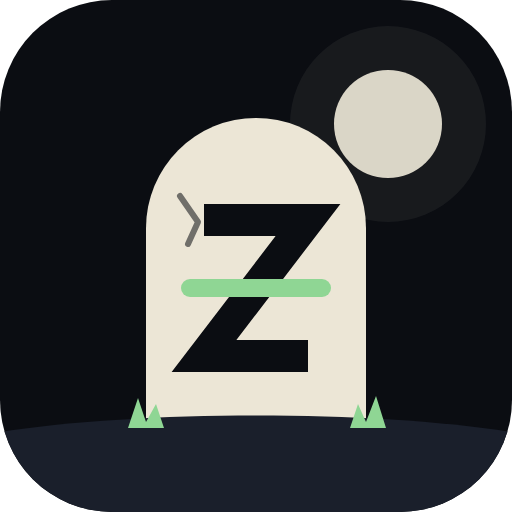

<p align="center">
  
</p>

<h1 align="center">The Reaper</h1>

<h3 align="center">You can bury your zombie subscriptions once. New ones rise every month.<br>The Reaper is a Kiro Crew app that re-checks your bank statements on the 1st, on your own machine,<br>and messages you when something new starts feeding or a price goes up.</h3>

<p align="center">
  <a href="#-install-it"></a>
  <a href="#-try-the-demo"></a>
  <a href="https://github.com/zaxcoraider/zombills"></a>
  <a href="https://zombills.netlify.app"></a>
</p>

<p align="center">
  <a href="https://kiro.dev/docs/crew"></a>
  <a href="#-the-zombills-ecosystem"></a>
  <a href="#%EF%B8%8F-how-it-works"></a>
  <a href="#%EF%B8%8F-how-it-works"></a>
  <a href="#-talk-to-it-on-telegram"></a>
  <a href="#-privacy"></a>
  <a href="#-proof"></a>
  <a href="LICENSE"></a>
</p>

<p align="center">
  <a href="#-what-you-get">What you get</a> ·
  <a href="#-the-zombills-ecosystem">Ecosystem</a> ·
  <a href="#%EF%B8%8F-how-it-works">How it works</a> ·
  <a href="#-privacy">Privacy</a> ·
  <a href="#-install-it">Install</a> ·
  <a href="#-talk-to-it-on-telegram">Telegram</a> ·
  <a href="#-try-the-demo">Demo</a> ·
  <a href="#-built-with-kiro">Built with Kiro</a> ·
  <a href="#-troubleshooting">Troubleshooting</a>
</p>

---

**The Reaper** is the monthly half of **[Zombills](https://github.com/zaxcoraider/zombills)**. On the 1st of each month it reads a folder of bank statement CSVs on your machine, runs the same Zombills detection engine on them, compares the result with last month, and tells you in chat about **new undead** (recurring charges it hasn't seen before) and **possessed** charges (price rises). Reply `bury Netflix` and it drafts the cancellation. A **Graveyard page** in the Crew dashboard shows each month's undead, what you buried, and what you save a year.

| 📅 **Watches every month**                                                                                                                                      | 💬 **Talks in your chat**                                                                                                | ⚰️ **Drafts the cancellation**                                                                                                                  |
| :-------------------------------------------------------------------------------------------------------------------------------------------------------------- | :----------------------------------------------------------------------------------------------------------------------- | :---------------------------------------------------------------------------------------------------------------------------------------------- |
| A Crew cron runs on the 1st at 09:00. It needs no app open and no button press. The first round counts what's there, and later rounds report only what changed. | Alerts go to Telegram (or the Crew dashboard chat). Ask it `graveyard`, `bury <name>` or `unbury <name>` in plain words. | The cancel link and steps for 59 known services, or a ready email for any other. It never cancels, logs in, opens links or sends email for you. |

<table>
  <tr>
    <td align="center" width="25%"><h3>~12 s</h3><sub>for a full monthly round,<br>scan to Telegram</sub></td>
    <td align="center" width="25%"><h3>0</h3><sub>statement rows sent<br>to the model</sub></td>
    <td align="center" width="25%"><h3>5</h3><sub>MCP tools, each returning<br>summaries only</sub></td>
    <td align="center" width="25%"><h3>453</h3><sub>automated tests,<br>all passing</sub></td>
  </tr>
</table>

## 🦇 What you get

A real alert from a live run (Crew 0.12.2, demo statements, Nov 17 2026):

```text
🦇 The Reaper's monthly round
New undead: Paramount+, $11.99 a month ($143.88 a year).
Possessed: Netflix went from $15.49 to $17.99 a month (+$30.00 a year).
Reply "bury <name>" and I will draft the cancellation.
```

Reply `bury Netflix` and it records a tombstone (`⚰️ Netflix is buried. You save $215.88 a year.`), then gives you the cancel link and steps. For a service without a known link, it drafts a cancellation email as a plain-text block you can copy. Either way, it reminds you that you still have to cancel with the service. If a buried service charges again next month, the Reaper tells you the cancellation may not have gone through.

## 🕸 The Zombills ecosystem

Zombills is two apps that share one engine. Use the website to clear out your graveyard today. Use The Reaper so new zombies never get comfortable again.

|                        | 🌐 **[Zombills](https://github.com/zaxcoraider/zombills)**                                | 🦇 **The Reaper** (this repo)                                                                        |
| ---------------------- | ----------------------------------------------------------------------------------------- | ---------------------------------------------------------------------------------------------------- |
| **What it is**         | A haunted web app                                                                         | A [Kiro Crew](https://kiro.dev/docs/crew) app                                                        |
| **When you use it**    | Once, whenever you want a clean-out                                                       | Every month, on its own                                                                              |
| **What it does**       | Finds every recurring charge, you bury the ones you don't use, and it shows how to cancel | Re-scans your statements folder on the 1st and messages you about **new undead** and **price rises** |
| **Where it runs**      | Your browser tab. Nothing is uploaded.                                                    | Your own machine (or your own EC2 box). Statements are read in place.                                |
| **How you talk to it** | Click, drag, keyboard                                                                     | Telegram or the Crew dashboard: reply `bury Netflix` and it drafts the cancellation                  |
| **Engine**             | `@zombills/core`                                                                          | The same `@zombills/core`, bundled in [`vendor/`](vendor/)                                           |
| **Try it**             | [zombills.netlify.app](https://zombills.netlify.app)                                      | [Install guide](#-install-it) below                                                                  |

## ⚙️ How it works

```
 Crew cron (1st, 09:00)
        │
        ▼
 Reaper agent ──▶ MCP server (on your machine) ──▶ your statements folder
        │            │  parse → normalise → detect → classify   (@zombills/core)
        │            │  compare with last month's history
        │            ▼
        │         summary only: new undead, possessed, risen after burial
        ▼
 send_message ──▶ Telegram / Crew chat          Graveyard page ◀── backend API
```

| Part                | What it is                                                                                                                                                              |
| ------------------- | ----------------------------------------------------------------------------------------------------------------------------------------------------------------------- |
| **Manifest**        | [`app.json`](app.json): one agent, one skill, one MCP server, the `Graveyard watch` cron, and a dashboard page                                                          |
| **MCP server**      | [`mcp/`](mcp/): `scan_statements`, `list_graveyard`, `bury`, `unbury`, `set_statements_folder`. It keeps the history in the app's own data folder.                      |
| **Agent and skill** | [`agents/reaper.json`](agents/reaper.json) and [`skills/reaper`](skills/reaper): the wording rules (no urgency, no claims it can't back) and what to do on each command |
| **Dashboard**       | [`backend/`](backend/) serves `/apps/zombills-reaper/api`, and [`ui/`](ui/) is the Graveyard page in the Crew dashboard                                                 |
| **Bundles**         | `mcp/dist`, `backend/dist` and `ui/dist` are committed, because Crew installs apps without running a build                                                              |

## 🔒 Privacy

Your statements are read **where they are**, on the machine that runs Crew. They are never copied or uploaded. Parsed rows live only in the MCP server's memory during a scan. Every tool returns **summaries only** (recurring charges, price changes, tombstones), never rows, balances, account numbers or one-off purchases. The Reaper's own code makes no network request. The only things that leave your machine are the summaries Crew sends to your chat channel and to the model provider that runs the agent.

The limits of that promise, stated plainly:

- Crew mounts its built-in `read`, `glob` and `grep` tools into every agent, and an app can't remove them. Only the agent prompt and the skill keep the agent away from your statement files. They are instructions, and Crew doesn't enforce them.
- A folder path you give the agent in chat is a tool argument, so it reaches the model provider. To keep the path on your machine, edit `data/settings.json` yourself (see [The statements folder](#-the-statements-folder)).
- Crew keeps the text of every alert in `~/.kiro/crew/cron-history`.
- kiro-cli (`<kiro home>/sessions/cli/<sid>.jsonl`) and Crew (`data_home()/sessions`) keep transcripts that hold every scan summary, bury draft and any path passed to the agent. They stay on your machine, but outside the Reaper's data folder, and the Reaper doesn't manage them. "Summaries only" limits what reaches them, not whether they exist.

## 📦 Install it

1. Install Kiro Crew 0.12.2.
2. Make sure your clone has no `<repo>/data` folder. A first install copies the source's `data/` into the installed app, so a development `data/settings.json` would travel with it.
3. Run `kirocrew app install <repo path>`.
4. Enable the app in the Crew dashboard: **Apps → Library → The Reaper → Enable**. The CLI refuses to enable third-party apps. Never set `agent.apps_allow_third_party` to get around that.
5. Set your timezone in Crew. The cron fires at 09:00 on the 1st in Crew's zone, or UTC if none is set.

The three bundles need no build. After you change source, run `npm ci && npm run build`, then `kirocrew app update zombills-reaper`. If you ever rename the cron in `app.json`, `app update` adds the new job and keeps the old one, so remove the old one with `kirocrew cron remove <id>`.

### 📁 The statements folder

Tell the Reaper agent in the dashboard chat which folder to watch, for example _"watch the folder at ~/Documents/statements"_. It answers with the folder's last name and how many statement files it found.

To keep the path off the model provider, edit `~/.kiro/crew/apps/zombills-reaper/data/settings.json` yourself instead. Crew 0.12.2 doesn't pass `setup.configSchema` values to apps, so the manifest only documents the setting.

Keep earlier statements in the folder, because detection needs repeated charges. The same charge on two accounts on the same day counts once.

## 💬 Talk to it on Telegram

Crew hides app-installed agents from Telegram's `/agent` picker, so the Reaper ships a script that makes a user-level copy named `reaper-chat`.

1. In the Crew dashboard, open **Settings → Messaging Channels** and connect your Telegram bot. The bot token lives in Crew only, never in this repo. Set the allowed user ID to your own (get it from @userinfobot). If the dashboard doesn't keep the ID, run `kirocrew config set telegram.allowed_user_ids '[<id>]'` and then `kirocrew restart`.
2. Run `npm run setup:telegram`. It reads `~/.kiro/agents/zombills-reaper--reaper.json` and writes `~/.kiro/agents/reaper-chat.json` (mode 0600) with the same prompt, tools and MCP servers. It won't overwrite a `reaper-chat.json` it didn't create unless you add `-- --force`.
3. In Telegram, send `/agent` and pick `reaper-chat`. Then try `graveyard` or `bury Netflix`. To switch back, send `/agent` and pick another agent.
4. Run `npm run setup:telegram` again after every `kirocrew app update zombills-reaper`.

If routing doesn't work for you, use the Reaper agent's chat in the Crew dashboard. It understands the same commands.

## ▶ Try the demo

[`mcp/fixtures/demo/`](mcp/fixtures/demo) holds fake statements in two rounds.

1. Copy `mcp/fixtures/demo/round-1/*.csv` into a new folder outside the repo, and set it as the statements folder.
2. Run the cron now: `kirocrew cron list`, find `zombills-reaper/Graveyard watch`, then `kirocrew cron trigger <id>`. The first count is **6 undead, $1,181.40 a year**.
3. Copy `mcp/fixtures/demo/round-2/*.csv` into the same folder and trigger it again. The alert names **Paramount+** as new undead and **Netflix** as possessed ($15.49 → $17.99 a month).
4. Reply `bury Netflix` for a cancel link, and `bury Planet Fitness` for a cancellation email.

You can also send _"scan my statements"_ to the Reaper in the dashboard chat. It runs the same scan and replies only in that chat.

## 🚫 What the Reaper never does

- It never cancels a service for you, logs in to one, or opens a link.
- It never sends an email for you. It drafts the text, and you send it.
- It never uploads your statements, and it links no bank account.

## 👻 Built with Kiro

Kiro wrote the spec, steering, agent, tests and code in this repo, and made the commits. Claude Code drove the Kiro CLI and ran the live checks on a real Crew install.

| Kiro feature        | How the Reaper uses it                                                                                                                                                                                                                                                                                                                      |
| ------------------- | ------------------------------------------------------------------------------------------------------------------------------------------------------------------------------------------------------------------------------------------------------------------------------------------------------------------------------------------- |
| 🦇 **Kiro Crew**    | The whole app: manifest, cron, an MCP server, an agent and skill, a backend, and a dashboard page                                                                                                                                                                                                                                           |
| 📐 **Spec**         | [`.kiro/specs/reaper`](.kiro/specs/reaper): requirements, design and 32 tasks, each reviewed by `spec-reviewer` (16 + 17 findings, 3 blockers fixed before any code)                                                                                                                                                                        |
| 🧪 **Live spike**   | [`spike-2026-11-17.md`](.kiro/specs/reaper/spike-2026-11-17.md): a throwaway app installed in a real Crew found 6 behaviours the docs don't mention (`$HOME` not expanded in the MCP launch, `@app:server` tool refs, `allowedTools` vs `autoApprove`, the `ui.entry` path, the page as a React component, app agents hidden from Telegram) |
| 🧭 **Steering**     | [`.kiro/steering`](.kiro/steering): `product`, `tech`, `structure`, `privacy`                                                                                                                                                                                                                                                               |
| 🕵️ **Custom agent** | [`.kiro/agents/spec-reviewer.json`](.kiro/agents/spec-reviewer.json), read-only                                                                                                                                                                                                                                                             |

## 🧾 Proof

| Check                                                 | Result                                                                                                                       |
| ----------------------------------------------------- | ---------------------------------------------------------------------------------------------------------------------------- |
| Unit, property and bundle tests (Vitest + fast-check) | **453** passing                                                                                                              |
| Live run on Crew 0.12.2                               | First count, round-2 alert, `bury` (link and email), `graveyard` and `unbury`, all verified on Telegram and in the dashboard |
| Cron delivery                                         | About 12 s per round once `@kirocrew-core/send_message` was allowed (it took 195 s before)                                   |

## 🛠 Troubleshooting

The Reaper's tools don't show up in the agent:

- The MCP server starts with `node`. If kiro-cli can't find `node` (22.18 or later) on the PATH it inherits from Crew, the server never starts. Make sure `node` is on the PATH of the shell that starts Crew.
- Crew looks for apps in `~/.kiro/crew`. If you set `KIROCREW_HOME` to anything else, the launch command in `app.json` (which points at `$HOME/.kiro/crew/apps/zombills-reaper`) won't find the server.

## ☁️ Later: your own EC2 instance

`kirocrew cloud` runs Crew on your own AWS EC2 instance. The same app and the same rules apply: the statements folder and the Reaper's data live on that instance, which you own. Don't add S3, log shipping of app data, or any other service that moves statement data off the instance.

## License

MIT. See [`LICENSE`](LICENSE).

<p align="center"><sub>Part of the <a href="https://github.com/zaxcoraider/zombills">Zombills</a> ecosystem, made for <a href="https://kiroween.devpost.com">Kiroween 2026</a>. 🦇</sub></p>
